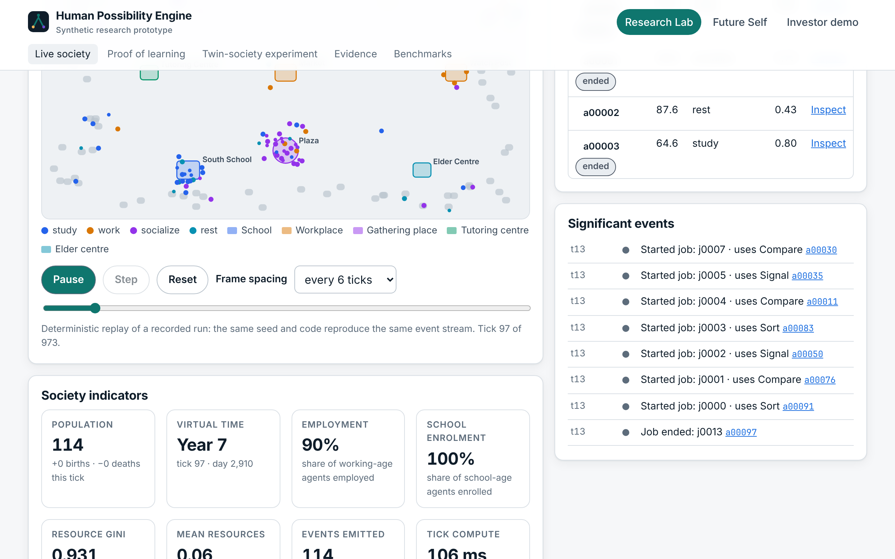
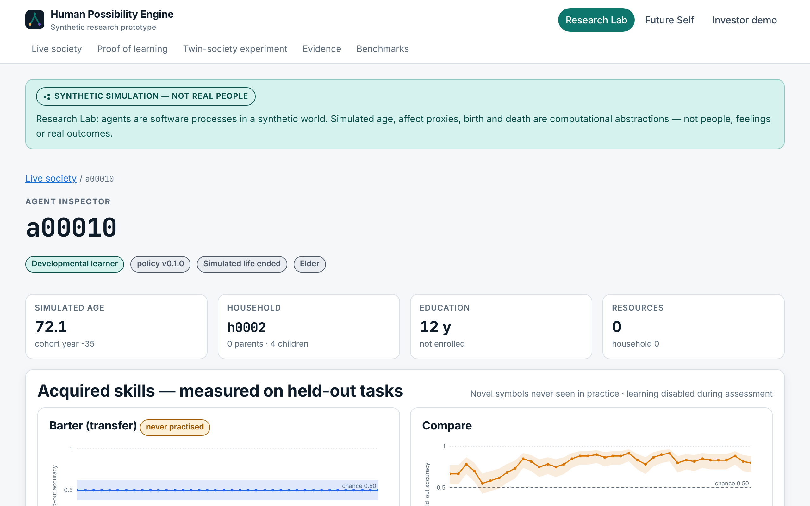
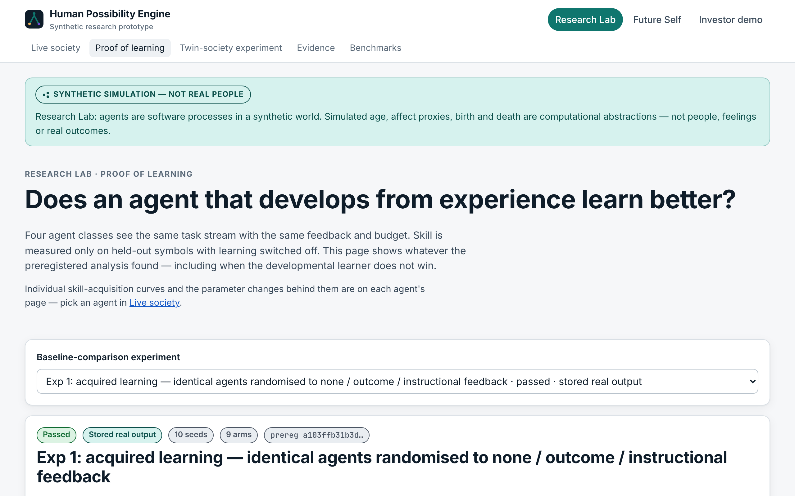
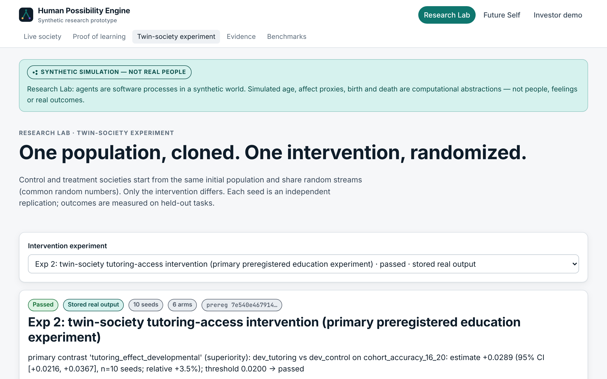
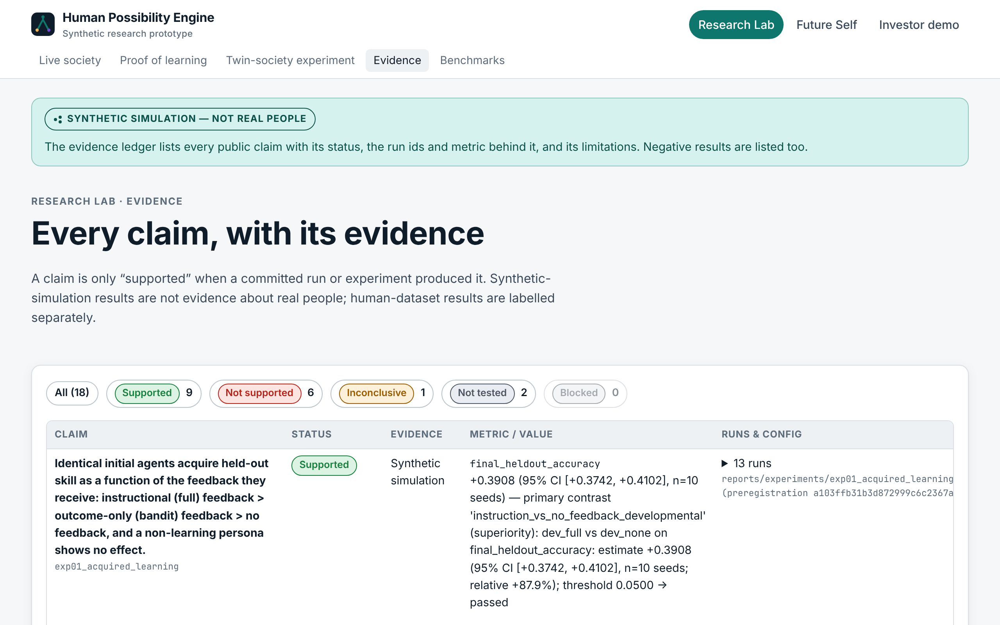
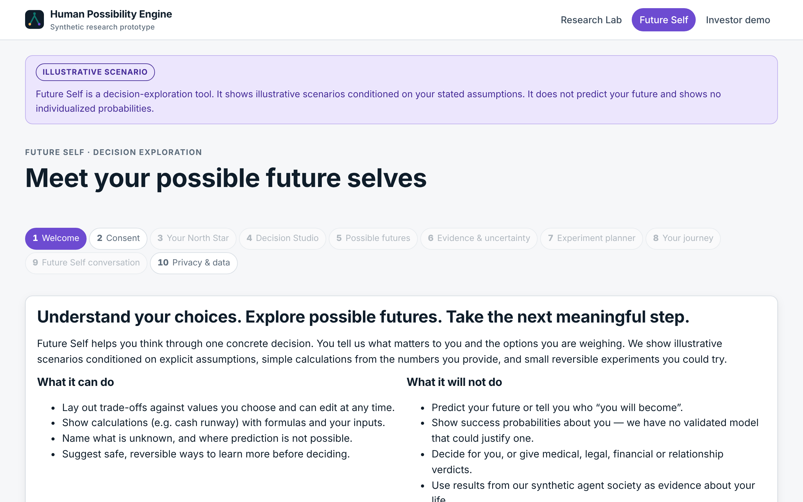
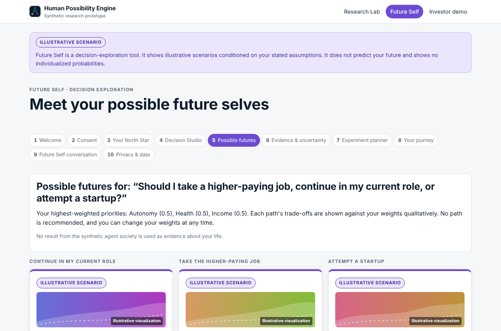
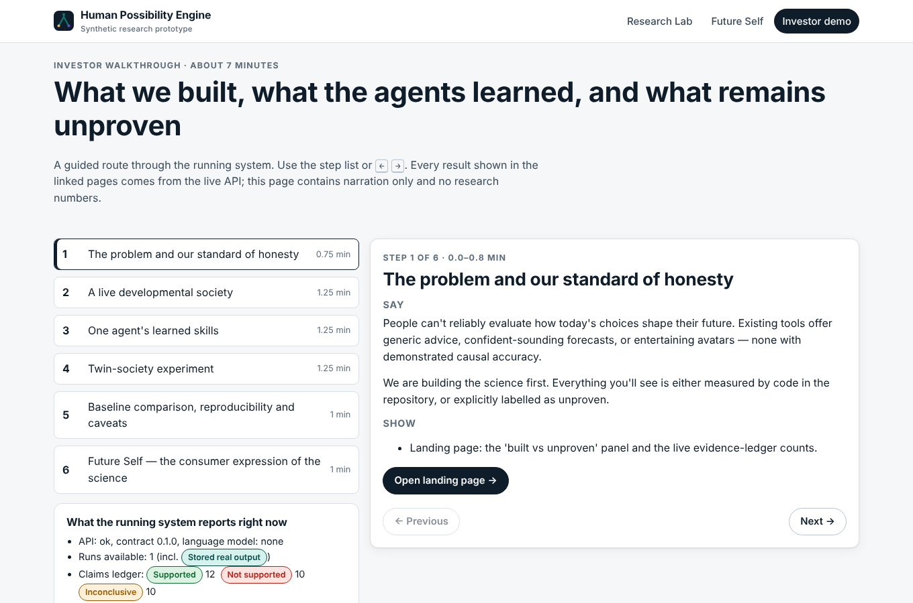

# Human Possibility Engine

> **Synthetic research prototype; not validated for predicting human futures.**
> Mission: give every human the power to make better decisions for their future self — grounded in
> science, not certainty theater.

[](https://github.com/AdityaJak/Human-possibility-engine/actions/workflows/ci.yml)

## The problem

People cannot test how today's choices shape their future. What exists is generic advice, persuasive
synthetic "futures", or chatbots with memory — none with demonstrated causal accuracy. We are building the
science first: a developmental-agent society for controlled experiments, honest benchmarks against strong
baselines, validation on real human data, and a consumer interface that explores possibilities without
pretending to predict fate.

## What is built, and what the evidence says

* **A developmental society that runs with no language model.** 100 agents, 80 simulated years, births,
  schooling, work, social ties, deaths; 138,607 logged events; replays bit-identically from its seed and
  from a mid-run checkpoint.
* **Real learning, measured honestly.** Agents practise tasks built from novel symbols no model has seen.
  Skill is measured only on held-out symbols with learning disabled. Freezing learning removes
  −0.41 accuracy; withholding feedback −0.27.
* **The decisive comparison — mixed, and published either way.** Against a written persona (+0.41) and a
  memory-only agent (+0.08) the developmental learner wins clearly. Against plain reinforcement
  learning on within-family skill it does **not** (preregistered H1 **failed**: +0.012, 95% CI
  [−0.008, +0.031]). Where it helps is transfer to an unseen task family (+0.09 AUC), and it transfers
  *negatively* when the structure is not shared.
* **Twin-society intervention.** Tutoring access raises held-out skill (+0.029 [+0.022, +0.037]); a
  society that cannot learn shows exactly zero effect — the mechanism check.
* **Social context — not supported as built.** Connected and isolated societies learn the same
  (−0.004 [−0.007, −0.000]), because developmental agents form almost no friendships (0.02 on average
  over 15 years). A mechanism gap, recorded as a failed preregistered test.
* **Midlife education — no effect.** Opening adult education at 38–45 changed nothing measurable in
  five years (−0.003 [−0.015, +0.007]); the design did not measure uptake. Recorded as failed.
* **Intergenerational transmission — inconclusive.** Under cross-fostering, children's skill
  correlates with neither rearing nor biological household (−0.075 [−0.177, +0.023] and −0.017): every
  child reaches the same plateau, so the design could not detect transmission.
* **Real human choices — mixed.** On held-out participants from Psych-101, the developmental learner
  predicts Iowa Gambling Task choices better than every other model tested (−0.110 nats vs the
  instance-based reference), but on the preregistered primary task (multiple-cue learning) it is clearly
  worse than exemplar-memory models (+0.229 nats). Human validity (Gate 4) is therefore **not passed**.
* **One real causal estimate.** Our estimator recovers the published HeartSteps V1 effect
  (+12.2% [−0.5%, +27.4%] vs published +14%).
* **Future Self.** Consent → values → 2–4 options → illustrative scenarios → evidence and "cannot
  predict" → reversible experiments → journey. No probabilities, ever; crisis and high-stakes routing
  independently audited.

Full numbers with intervals and artifacts: [`RESEARCH_RESULTS.md`](RESEARCH_RESULTS.md). Generated claims
ledger: [`docs/EVIDENCE.md`](docs/EVIDENCE.md). Limits: [`docs/CLAIMS_AND_LIMITATIONS.md`](docs/CLAIMS_AND_LIMITATIONS.md).
Independent audit: [`reports/audit/AUDIT.md`](reports/audit/AUDIT.md).

## Screenshots (production build against the real API, stored real outputs)

| Live society | Agent inspector |
|---|---|
|  |  |

| Proof of learning (preregistered results, failures included) | Twin-society experiment |
|---|---|
|  |  |

| Evidence ledger | Future Self |
|---|---|
|  |  |

## Deployment

* **Static site (GitHub Pages) — live: <https://adityajak.github.io/Human-possibility-engine/>.** The
  whole research dashboard runs with no backend: every read endpoint is pre-rendered from the committed
  stored real outputs by the real API code (`scripts/export_static_api.py`), and Future Self runs the
  repository's own Python engine (`hpe.futures`) in the browser via Pyodide, keeping user data in the
  browser. Built, deployed and browser-verified by `.github/workflows/pages.yml` on every push; verified
  from this session against the live site: 9/9 routes, Future Self end to end in 11.1 s, zero errors
  (`docs/DEPLOYMENT.md`).
* **Live API + web app** (interactive simulations, experiment runs): `render.yaml` and
  `apps/web/vercel.json` are ready; they need your Render/Vercel accounts. Public deployments run the
  API in read-only mode (`HPE_READ_ONLY=1`): no simulation or experiment jobs are exposed.

| Live site: Future Self scenarios (real engine in the browser) | Live site: investor walkthrough |
|---|---|
|  |  |

Both captured by `scripts/e2e/` against <https://adityajak.github.io/Human-possibility-engine/> on 2026-11-04.

## Install and run (one machine, no API keys, works offline)

Requirements: Python ≥ 3.12, [uv](https://docs.astral.sh/uv/), Node 22.

```bash
git clone https://github.com/AdityaJak/Human-possibility-engine.git && cd Human-possibility-engine
make setup                  # Python venv + web dependencies
make test                   # Python (unit + integration against the real simulator) + web tests
make demo                   # API on :8000 and web app on :5173 → open http://127.0.0.1:5173/demo
```

Other entry points:

```bash
make smoke                                          # 25 agents × 3 years, run twice, replay hashes must match
python -m hpe.cli demo-run --seed 42                # the stored 100-agent × 80-year run (≈2 min)
python -m hpe.cli verify-replay reports/runs/demo_developmental_100a_80y_s42
python -m hpe.evaluation run experiments/exp06_transfer.yaml --workers 3     # a preregistered experiment
python -m hpe.evaluation analyze reports/experiments/exp_baselines_heldout   # regenerate from raw logs
make human-experiments                              # Psych-101 + HeartSteps (downloads, licences in docs/DATA_SOURCES.md)
docker compose up --build                           # containers (compose config validated; images not yet built in CI)
```

## Architecture

```
Tier 5  Future Self app           apps/web (consumer zone) ── hpe.futures (templates, calculators, safety)
Tier 4  Evidence-grounded research hpe.evaluation (+ .human: Psych-101, HeartSteps) ── reports/ (committed artifacts)
Tier 3  Optional language model    narration adapter only; disabled by default; never a source of numbers
Tier 2  Trainable learning         hpe.development (developmental learner) + hpe.evaluation.baselines
Tier 1  Simulation infrastructure  hpe.world (society) + hpe.tasks (novel symbols) + hpe.core (RNG streams)
                                   hpe.storage (SQLite, JSONL, checkpoints) ── apps/api (FastAPI)
```

Details: [`ARCHITECTURE.md`](ARCHITECTURE.md), interfaces [`docs/INTERFACES.md`](docs/INTERFACES.md),
decisions [`docs/ADRS/`](docs/ADRS/), protocol [`docs/RESEARCH_PROTOCOL.md`](docs/RESEARCH_PROTOCOL.md),
model cards [`docs/MODEL_CARDS.md`](docs/MODEL_CARDS.md), API [`docs/openapi.json`](docs/openapi.json).

## Benchmarks (measured; hardware and load disclosed in each record)

| Workload | Wall time | Throughput | Peak RSS | Record |
|---|---|---|---|---|
| 100 agents × 80 years, developmental | 117 s | ≈68 agent-years/s | 356 MB | `reports/runs/demo_developmental_100a_80y_s42/manifest.json` |
| 100 agents × 2 years, developmental | 5.45 s | 38.7 agent-years/s | 100 MB | `reports/scale/developmental_100a_2y_dt30_s0.json` |
| 1,000 agents × 10 years, developmental | 165.7 s | 64.2 agent-years/s | 912 MB | `reports/scale/developmental_1000a_10y_dt30_s0_20261104T052934Z.json` |
| 10,000 agents × 1 year, developmental | 720.7 s | 15.0 agent-years/s overall; 476 s is one-time population prehistory, steady state ≈18.7 s per 30-day tick | 5.1 GB | `reports/scale/developmental_10000a_1y_dt30_s0_20261104T054544Z.json` (+ profile) |

4-vCPU x86_64, 15.7 GiB RAM, shared with other jobs during measurement. $0 in API calls.

## Research caveats

Simulated results come from a synthetic world whose every mechanism is an assumption; effects may simply
reflect those assumptions and are not estimates of real-world causal effects. Age effects are partly
scripted. Task rules are linear (a plain linear learner is near-optimal within a family). The
developmental learner's hyperparameters were tuned on a seed that overlaps the evaluation seeds (audit
recomputation without it: verdicts unchanged). See `docs/scientific_assumptions.md` and `docs/RISKS.md`.

## Roadmap

[`NEXT_STEPS.md`](NEXT_STEPS.md): fix the research hypothesis first (non-linear/non-stationary tasks,
component redesign, noise robustness, tuning hygiene), then human validity (Gate 4), then scale (1k/10k
benchmarks), then a prospective human study after ethics review. Status of every deliverable:
[`BUILD_STATUS.md`](BUILD_STATUS.md). Task board: [`tasks/board.yaml`](tasks/board.yaml).

## Repository

Built by coordinated Claude Code workers in lanes with frozen contracts ([`AGENTS.md`](AGENTS.md)).
Contributing: [`CONTRIBUTING.md`](CONTRIBUTING.md) · Security: [`SECURITY.md`](SECURITY.md) ·
Conduct: [`CODE_OF_CONDUCT.md`](CODE_OF_CONDUCT.md) · Changes: [`CHANGELOG.md`](CHANGELOG.md).
**License: not yet assigned** (all rights reserved until the founder chooses; ADR-0007).
