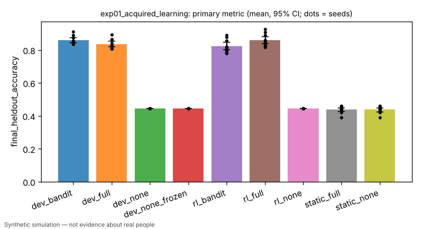
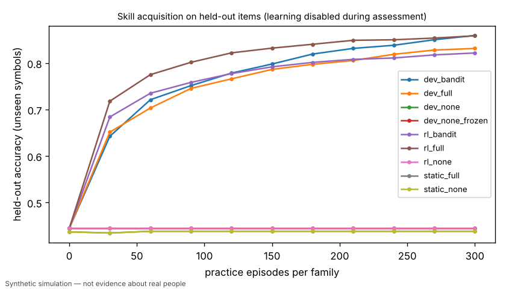
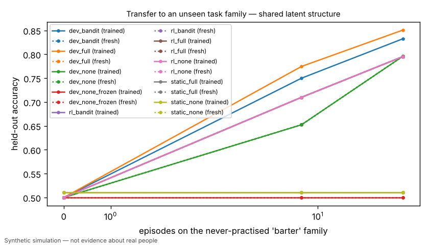

# Exp 1: acquired learning — identical agents randomised to none / outcome / instructional feedback

> Simulated result from a synthetic world. Effects may simply reflect assumptions built into the simulator and are not estimates of real-world causal effects.

- Experiment id: `exp01_acquired_learning`  
- Preregistration hash: `a103ffb31b3d872999c6c2367a278da7` (written to definition.json before any run)  
- Protocol: `learning_lab`; seeds: [0, 1, 2, 3, 4, 5, 6, 7, 8, 9]; arms: dev_none, dev_bandit, dev_full, dev_none_frozen, rl_none, rl_bandit, rl_full, static_none, static_full  
- Status: **PASSED** — primary contrast 'instruction_vs_no_feedback_developmental' (superiority): dev_full vs dev_none on final_heldout_accuracy: estimate +0.3908 (95% CI [+0.3742, +0.4102], n=10 seeds; relative +87.9%); threshold 0.0500 -> passed

## Hypothesis and falsification criterion

**Hypothesis.** Identical initial agents acquire held-out skill as a function of the feedback they receive: instructional (full) feedback > outcome-only (bandit) feedback > no feedback, and a non-learning persona shows no effect.

**Falsification criterion.** Not supported if dev_full fails to exceed dev_none by >= 0.05 held-out accuracy with the paired 95% CI excluding 0 across 10 seeds. The mechanism check fails if static_full and static_none differ by more than 0.02.

**Primary metric.** `final_heldout_accuracy` — Mean held-out accuracy over training families after 300 episodes/family; mean over 20 agents; one value per seed.

## Arm summaries (mean over seeds, 95% bootstrap CI)

| arm | n seeds | `final_heldout_accuracy` | `episodes_to_criterion/compare` | `retention_change` | `final_log_loss` | `transfer_auc/shared/trained` |
|---|---|---|---|---|---|---|
| dev_bandit | 10 | 0.859 [0.845, 0.875] | 43.200 [39.450, 48.150] | -0.012 [-0.015, -0.009] | 0.378 [0.329, 0.426] | 0.694 [0.662, 0.721] |
| dev_full | 10 | 0.835 [0.819, 0.854] | 45.900 [42.150, 49.950] | -0.021 [-0.027, -0.015] | 0.377 [0.339, 0.410] | 0.708 [0.672, 0.737] |
| dev_none | 10 | 0.444 [0.444, 0.444] | 600.000 [600.000, 600.000] | 0.000 [0.000, 0.000] | 0.828 [0.828, 0.828] | 0.649 [0.635, 0.665] |
| dev_none_frozen | 10 | 0.444 [0.444, 0.444] | 600.000 [600.000, 600.000] | 0.000 [0.000, 0.000] | 0.828 [0.828, 0.828] | 0.500 [0.500, 0.500] |
| rl_bandit | 10 | 0.822 [0.799, 0.847] | 37.350 [35.100, 39.600] | 0.000 [0.000, 0.000] | 0.414 [0.370, 0.451] | 0.668 [0.650, 0.686] |
| rl_full | 10 | 0.859 [0.838, 0.882] | 34.500 [32.850, 36.150] | 0.000 [0.000, 0.000] | 0.347 [0.309, 0.381] | 0.668 [0.651, 0.686] |
| rl_none | 10 | 0.444 [0.444, 0.444] | 600.000 [600.000, 600.000] | 0.000 [0.000, 0.000] | 0.828 [0.828, 0.828] | 0.668 [0.651, 0.687] |
| static_full | 10 | 0.438 [0.425, 0.449] | 560.850 [546.450, 574.800] | 0.000 [0.000, 0.000] | 2.905 [2.768, 3.072] | 0.511 [0.495, 0.526] |
| static_none | 10 | 0.438 [0.425, 0.449] | 560.850 [546.600, 574.800] | 0.000 [0.000, 0.000] | 2.905 [2.771, 3.078] | 0.511 [0.495, 0.526] |

## Preregistered contrasts

| contrast | kind | treatment | control | estimate | 95% CI | relative | p | verdict |
|---|---|---|---|---|---|---|---|---|
| instruction_vs_no_feedback_developmental (primary) | superiority | dev_full | dev_none | +0.3908 | [+0.3742, +0.4102] | +87.9% | 0.0020 | **passed** |
| outcome_feedback_vs_none_developmental | superiority | dev_bandit | dev_none | +0.4143 | [+0.4007, +0.4300] | +93.2% | 0.0059 (Holm) | **passed** |
| instruction_vs_outcome_efficiency_developmental | superiority | dev_full | dev_bandit | +2.7000 | [-0.7500, +6.1500] | -6.2% | 0.2148 (Holm) | **inconclusive** |
| no_feedback_learning_is_null_developmental | equivalence | dev_none | dev_none_frozen | +0.0000 | [+0.0000, +0.0000] | +0.0% | CI vs margin 0.03 | **passed** |
| instruction_vs_no_feedback_plain_rl | superiority | rl_full | rl_none | +0.4144 | [+0.3928, +0.4374] | +93.2% | 0.0059 (Holm) | **passed** |
| mechanism_check_static_persona | equivalence | static_full | static_none | +0.0000 | [+0.0000, +0.0000] | +0.0% | CI vs margin 0.02 | **passed** |
| retention_developmental_full | exploratory | dev_full | rl_full | -0.0210 | [-0.0268, -0.0148] | +nan% | 0.0020 | **exploratory** |

## Contamination checks (from raw logs)

- `leakage/assessment_mutated_policy`: max over runs = 0
- `leakage/holdout_symbols_in_practice`: max over runs = 0
- `leakage/practice_items`: max over runs = 18180

## Figures (regenerated from raw logs)





## Compute

- Runs: 90; total wall time 602.8 s; LLM calls: 0; paid API cost: $0.
- Hardware: x86_64 4 cpu, Linux 6.18.44-fc-v233, python 3.13.18

## Limitations

- Feedback conditions are properties of the synthetic environment; 'instruction' here means revealing the correct answer, not human teaching.
- Retention measures forgetting dynamics built into each policy class (baselines do not forget by construction).
- Simulated result from a synthetic world. Effects may simply reflect assumptions built into the simulator and are not estimates of real-world causal effects.

## Reproduce

```bash
python -m hpe.evaluation run experiments/exp01_acquired_learning.yaml
python -m hpe.evaluation analyze <out>/exp01_acquired_learning   # regenerates result.json from raw logs
```
