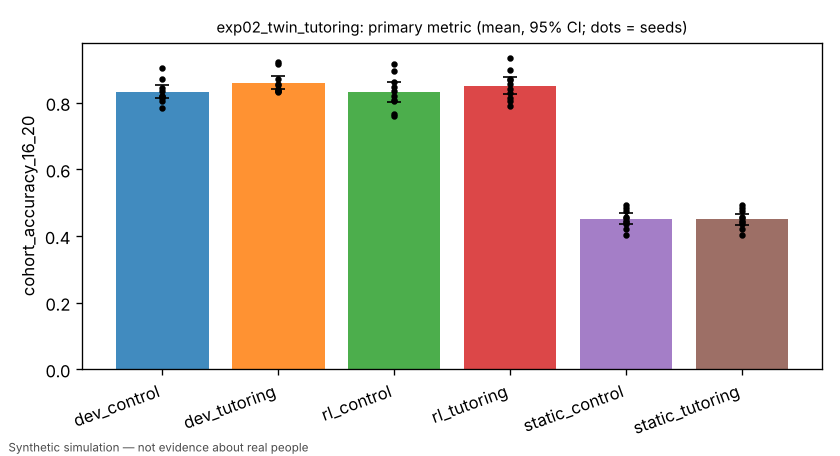

# Exp 2: twin-society tutoring-access intervention (primary preregistered education experiment)

> Simulated result from a synthetic world. Effects may simply reflect assumptions built into the simulator and are not estimates of real-world causal effects.

- Experiment id: `exp02_twin_tutoring`  
- Preregistration hash: `7e540e467914fb1d3eb0c17891b379ba` (written to definition.json before any run)  
- Protocol: `society`; seeds: [0, 1, 2, 3, 4, 5, 6, 7, 8, 9]; arms: dev_control, dev_tutoring, rl_control, rl_tutoring, static_control, static_tutoring  
- Status: **PASSED** — primary contrast 'tutoring_effect_developmental' (superiority): dev_tutoring vs dev_control on cohort_accuracy_16_20: estimate +0.0289 (95% CI [+0.0216, +0.0367], n=10 seeds; relative +3.5%); threshold 0.0200 -> passed

## Hypothesis and falsification criterion

**Hypothesis.** In a society of developmental learners, giving every child aged 5-15 access to tutoring (extra instructional feedback episodes) raises held-out task accuracy at ages 16-20 relative to a cloned control society, and the effect appears only when agents can learn.

**Falsification criterion.** Not supported if dev_tutoring - dev_control on cohort_accuracy_16_20 is < 0.02 or its paired 95% CI includes 0 across 10 seed pairs. The mechanism claim fails if static_tutoring - static_control falls outside +/-0.02.

**Primary metric.** `cohort_accuracy_16_20` — At simulated year 20: mean over alive agents aged 16-20 of their latest held-out assessment accuracy averaged over the training families (world-run hpe.tasks.assess, learning disabled); one value per society (seed).

## Arm summaries (mean over seeds, 95% bootstrap CI)

| arm | n seeds | `cohort_accuracy_16_20` | `cohort_size_16_20` | `tutored_share_16_20` | `cohort_accuracy_8_12` | `cohort_barter_16_20` | `employment_18_30` | `education_years_16_20` | `resource_gini` | `population` |
|---|---|---|---|---|---|---|---|---|---|---|
| dev_control | 10 | 0.831 [0.812, 0.853] | 7.300 [6.200, 8.500] | 0.000 [0.000, 0.000] | 0.757 [0.722, 0.791] | 0.500 [0.500, 0.500] | 0.584 [0.548, 0.625] | 11.455 [11.293, 11.630] | 0.873 [0.859, 0.886] | 117.700 [115.500, 119.900] |
| dev_tutoring | 10 | 0.860 [0.842, 0.881] | 7.300 [6.200, 8.500] | 0.000 [0.000, 0.000] | 0.758 [0.716, 0.797] | 0.500 [0.500, 0.500] | 0.587 [0.551, 0.622] | 11.455 [11.285, 11.635] | 0.877 [0.866, 0.890] | 117.300 [114.600, 120.200] |
| rl_control | 10 | 0.831 [0.803, 0.862] | 7.300 [6.200, 8.400] | 0.000 [0.000, 0.000] | 0.770 [0.741, 0.801] | 0.500 [0.500, 0.500] | 0.581 [0.554, 0.609] | 11.455 [11.280, 11.633] | 0.834 [0.826, 0.844] | 117.900 [115.800, 120.000] |
| rl_tutoring | 10 | 0.850 [0.825, 0.876] | 7.300 [6.200, 8.400] | 0.000 [0.000, 0.000] | 0.806 [0.783, 0.829] | 0.500 [0.500, 0.500] | 0.656 [0.614, 0.697] | 11.455 [11.286, 11.634] | 0.843 [0.834, 0.852] | 118.200 [116.100, 120.400] |
| static_control | 10 | 0.451 [0.435, 0.467] | 7.300 [6.200, 8.500] | 0.000 [0.000, 0.000] | 0.472 [0.443, 0.500] | 0.466 [0.441, 0.496] | 0.577 [0.539, 0.620] | 11.455 [11.283, 11.631] | 0.734 [0.719, 0.749] | 117.700 [115.600, 119.900] |
| static_tutoring | 10 | 0.451 [0.435, 0.468] | 7.300 [6.200, 8.400] | 0.000 [0.000, 0.000] | 0.472 [0.443, 0.500] | 0.466 [0.440, 0.495] | 0.579 [0.537, 0.621] | 11.455 [11.288, 11.635] | 0.736 [0.724, 0.747] | 117.700 [115.400, 120.200] |

## Preregistered contrasts

| contrast | kind | treatment | control | estimate | 95% CI | relative | p | verdict |
|---|---|---|---|---|---|---|---|---|
| tutoring_effect_developmental (primary) | superiority | dev_tutoring | dev_control | +0.0289 | [+0.0216, +0.0367] | +3.5% | 0.0020 | **passed** |
| mechanism_check_static_persona | equivalence | static_tutoring | static_control | +0.0000 | [+0.0000, +0.0000] | +0.0% | CI vs margin 0.02 | **passed** |
| manipulation_check | superiority | dev_tutoring | dev_control | +0.0000 | [+0.0000, +0.0000] | +nan% | 1.0000 (Holm) | **failed** |
| tutoring_effect_plain_rl | superiority | rl_tutoring | rl_control | +0.0192 | [+0.0006, +0.0366] | +2.3% | 0.1680 (Holm) | **passed** |
| tutoring_effect_on_transfer_family | exploratory | dev_tutoring | dev_control | +0.0000 | [+0.0000, +0.0000] | +0.0% | 1.0000 | **exploratory** |
| tutoring_effect_on_employment | exploratory | dev_tutoring | dev_control | +0.0029 | [-0.0321, +0.0382] | +0.5% | 0.8594 | **exploratory** |
| spillover_to_adults | exploratory | dev_tutoring | dev_control | +0.0042 | [+0.0010, +0.0074] | +0.5% | 0.0371 | **exploratory** |

## Sensitivity analyses

| variant | params | contrast | estimate | 95% CI | verdict |
|---|---|---|---|---|---|
| high_label_noise | `{"label_noise": 0.15}` | tutoring_effect_developmental | +0.0013 | [-0.0058, +0.0112] | failed |
| no_age_gate | `{"enable_age_gate": false}` | tutoring_effect_developmental | +0.0134 | [+0.0046, +0.0238] | inconclusive |
| tutoring_episodes_2 | `{"tutoring_episodes_per_tick": 2}` | tutoring_effect_developmental | +0.0232 | [+0.0136, +0.0332] | passed |
| tutoring_episodes_8 | `{"tutoring_episodes_per_tick": 8}` | tutoring_effect_developmental | +0.0265 | [+0.0172, +0.0348] | passed |

## Figures (regenerated from raw logs)



## Compute

- Runs: 140; total wall time 4766.0 s; LLM calls: 0; paid API cost: $0.
- Hardware: x86_64 4 cpu, Linux 6.18.44-fc-v233, python 3.13.18

## Limitations

- Simulated effects reflect the simulator's assumption that tutoring = extra instructional-feedback episodes; they are not estimates of real tutoring effects.
- Cohorts after year 0 include agents born during the run; births can differ between arms through downstream dynamics.
- Depends on hpe.world semantics for tutoring_access and AgentState.tutored (sim/world lane).
- Simulated result from a synthetic world. Effects may simply reflect assumptions built into the simulator and are not estimates of real-world causal effects.

## Reproduce

```bash
python -m hpe.evaluation run experiments/exp02_twin_tutoring.yaml
python -m hpe.evaluation analyze <out>/exp02_twin_tutoring   # regenerates result.json from raw logs
```
