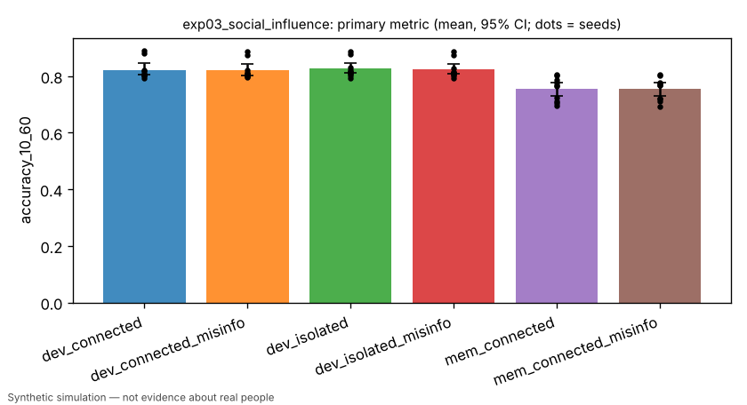

# Exp 3: social influence — connected vs isolated communities and misinformation robustness

> Simulated result from a synthetic world. Effects may simply reflect assumptions built into the simulator and are not estimates of real-world causal effects.

- Experiment id: `exp03_social_influence`  
- Preregistration hash: `f6531c961d92be5b2b407b4048087e07` (written to definition.json before any run)  
- Protocol: `society`; seeds: [0, 1, 2, 3, 4, 5, 6, 7, 8, 9]; arms: dev_connected, dev_isolated, dev_connected_misinfo, dev_isolated_misinfo, mem_connected, mem_connected_misinfo  
- Status: **FAILED** — primary contrast 'connection_effect' (superiority): dev_connected vs dev_isolated on accuracy_10_60: estimate -0.0040 (95% CI [-0.0074, -0.0002], n=10 seeds; relative -0.5%); threshold — -> failed

## Hypothesis and falsification criterion

**Hypothesis.** In a connected community, trust-weighted social learning diffuses skill so held-out accuracy (ages 10-60, year 15) exceeds an otherwise identical isolated community; seeded misinformation lowers accuracy, less so for a learner that discounts demonstrations conflicting with its own evidence.

**Falsification criterion.** Not supported if dev_connected - dev_isolated on accuracy_10_60 has a paired 95% CI including or below 0 across 10 seeds.

**Primary metric.** `accuracy_10_60` — Year 15: mean held-out accuracy (training families) over alive agents aged 10-60; one value per society.

## Arm summaries (mean over seeds, 95% bootstrap CI)

| arm | n seeds | `accuracy_10_60` | `youth_accuracy_10_20` | `mean_friends` | `employment_18_65` |
|---|---|---|---|---|---|
| dev_connected | 10 | 0.823 [0.805, 0.844] | 0.830 [0.813, 0.851] | 0.018 [0.004, 0.036] | 0.664 [0.640, 0.692] |
| dev_connected_misinfo | 10 | 0.821 [0.804, 0.841] | 0.829 [0.811, 0.850] | 0.027 [0.011, 0.047] | 0.660 [0.632, 0.689] |
| dev_isolated | 10 | 0.827 [0.810, 0.847] | 0.831 [0.813, 0.851] | 0.000 [0.000, 0.000] | 0.663 [0.636, 0.692] |
| dev_isolated_misinfo | 10 | 0.824 [0.808, 0.846] | 0.834 [0.816, 0.855] | 0.000 [0.000, 0.000] | 0.664 [0.638, 0.692] |
| mem_connected | 10 | 0.754 [0.729, 0.777] | 0.764 [0.741, 0.786] | 0.490 [0.141, 1.003] | 0.664 [0.640, 0.691] |
| mem_connected_misinfo | 10 | 0.754 [0.731, 0.777] | 0.763 [0.739, 0.786] | 0.399 [0.086, 0.796] | 0.663 [0.637, 0.691] |

## Preregistered contrasts

| contrast | kind | treatment | control | estimate | 95% CI | relative | p | verdict |
|---|---|---|---|---|---|---|---|---|
| connection_effect (primary) | superiority | dev_connected | dev_isolated | -0.0040 | [-0.0074, -0.0002] | -0.5% | 0.0684 | **failed** |
| misinformation_harm_connected | exploratory | dev_connected_misinfo | dev_connected | -0.0017 | [-0.0048, +0.0014] | +0.2% | 0.3242 | **exploratory** |
| misinformation_harm_isolated | exploratory | dev_isolated_misinfo | dev_isolated | -0.0022 | [-0.0045, +0.0000] | +0.3% | 0.0820 | **exploratory** |
| memory_only_misinformation_harm | exploratory | mem_connected_misinfo | mem_connected | +0.0001 | [-0.0032, +0.0043] | -0.0% | 0.9648 | **exploratory** |
| manipulation_check_isolation | superiority | dev_connected | dev_isolated | +0.0185 | [+0.0057, +0.0359] | +nan% | 0.0625 (Holm) | **passed** |

## Sensitivity analyses

| variant | params | contrast | estimate | 95% CI | verdict |
|---|---|---|---|---|---|
| more_peer_demos | `{"peer_demonstrations_per_social_tick": 4}` | connection_effect | -0.0062 | [-0.0095, -0.0026] | failed |

## Figures (regenerated from raw logs)



## Compute

- Runs: 80; total wall time 3342.7 s; LLM calls: 0; paid API cost: $0.
- Hardware: x86_64 4 cpu, Linux 6.18.44-fc-v233, python 3.13.18

## Limitations

- Misinformation is a fictional-task construct (wrong demonstrations presented as correct); it says nothing about real-world misinformation.
- Depends on hpe.world semantics for social_isolation and misinformation interventions.
- Simulated result from a synthetic world. Effects may simply reflect assumptions built into the simulator and are not estimates of real-world causal effects.

## Reproduce

```bash
python -m hpe.evaluation run experiments/exp03_social_influence.yaml
python -m hpe.evaluation analyze <out>/exp03_social_influence   # regenerates result.json from raw logs
```
