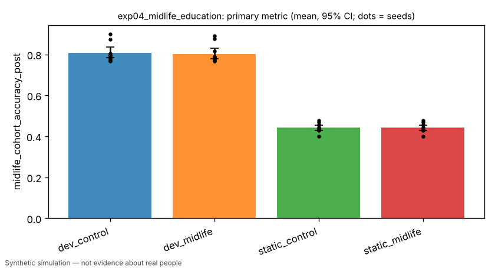

# Exp 4: midlife education opportunity (ages 38-45, years 10-15)

> Simulated result from a synthetic world. Effects may simply reflect assumptions built into the simulator and are not estimates of real-world causal effects.

- Experiment id: `exp04_midlife_education`  
- Preregistration hash: `1b9968b99bb0f28beb5e89b64e7ff752` (written to definition.json before any run)  
- Protocol: `society`; seeds: [0, 1, 2, 3, 4, 5, 6, 7, 8, 9]; arms: dev_control, dev_midlife, static_control, static_midlife  
- Status: **FAILED** — primary contrast 'midlife_education_effect_developmental' (superiority): dev_midlife vs dev_control on midlife_cohort_accuracy_post: estimate -0.0031 (95% CI [-0.0145, +0.0073], n=10 seeds; relative -0.4%); threshold 0.0200 -> failed

## Hypothesis and falsification criterion

**Hypothesis.** Developmental agents adapt to a late-life educational opportunity: the targeted cohort's held-out accuracy at year 15 exceeds the cloned control cohort, which a deterministic age script could not produce; non-learners show no effect.

**Falsification criterion.** Not supported if dev_midlife - dev_control on midlife_cohort_accuracy_post is < 0.02 or its paired 95% CI includes 0.

**Primary metric.** `midlife_cohort_accuracy_post` — Year 15: mean held-out accuracy of alive agents aged 43-50 (aged 38-45 when the opportunity opened).

## Arm summaries (mean over seeds, 95% bootstrap CI)

| arm | n seeds | `midlife_cohort_accuracy_post` | `midlife_cohort_accuracy_pre` | `midlife_cohort_size_post` | `midlife_employment_post` |
|---|---|---|---|---|---|
| dev_control | 10 | 0.806 [0.783, 0.834] | 0.802 [0.779, 0.830] | 12.300 [9.700, 14.900] | 0.677 [0.604, 0.756] |
| dev_midlife | 10 | 0.803 [0.779, 0.832] | 0.802 [0.779, 0.828] | 12.300 [9.700, 15.000] | 0.706 [0.630, 0.780] |
| static_control | 10 | 0.443 [0.429, 0.456] | 0.445 [0.431, 0.457] | 12.300 [9.798, 15.100] | 0.702 [0.639, 0.750] |
| static_midlife | 10 | 0.443 [0.429, 0.456] | 0.445 [0.431, 0.457] | 12.300 [9.500, 14.903] | 0.702 [0.639, 0.749] |

## Preregistered contrasts

| contrast | kind | treatment | control | estimate | 95% CI | relative | p | verdict |
|---|---|---|---|---|---|---|---|---|
| midlife_education_effect_developmental (primary) | superiority | dev_midlife | dev_control | -0.0031 | [-0.0145, +0.0073] | -0.4% | 0.5996 | **failed** |
| pre_period_balance | equivalence | dev_midlife | dev_control | -0.0004 | [-0.0019, +0.0009] | -0.1% | CI vs margin 0.01 | **passed** |
| mechanism_check_static_persona | equivalence | static_midlife | static_control | +0.0000 | [+0.0000, +0.0000] | +0.0% | CI vs margin 0.02 | **passed** |
| midlife_employment | exploratory | dev_midlife | dev_control | +0.0284 | [-0.0350, +0.1023] | +4.2% | 0.4688 | **exploratory** |

## Figures (regenerated from raw logs)



## Compute

- Runs: 40; total wall time 799.1 s; LLM calls: 0; paid API cost: $0.
- Hardware: x86_64 4 cpu, Linux 6.18.44-fc-v233, python 3.13.18

## Limitations

- Adult plasticity is a modelling assumption of the developmental learner (plasticity schedule); results inherit it.
- Depends on hpe.world semantics for midlife_education.
- Simulated result from a synthetic world. Effects may simply reflect assumptions built into the simulator and are not estimates of real-world causal effects.

## Reproduce

```bash
python -m hpe.evaluation run experiments/exp04_midlife_education.yaml
python -m hpe.evaluation analyze <out>/exp04_midlife_education   # regenerates result.json from raw logs
```
