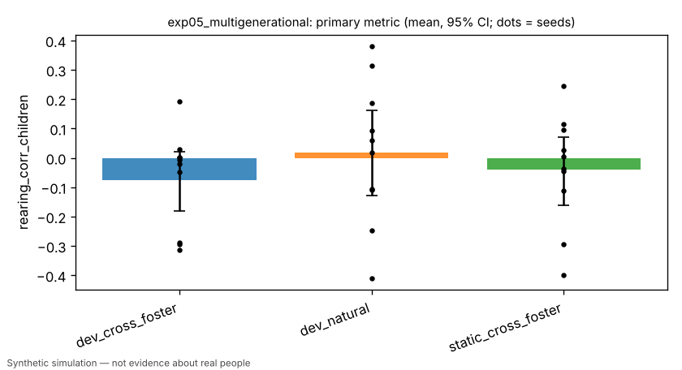

# Exp 5: multigenerational transmission — inherited initial conditions vs acquired (cross-fostering)

> Simulated result from a synthetic world. Effects may simply reflect assumptions built into the simulator and are not estimates of real-world causal effects.

- Experiment id: `exp05_multigenerational`  
- Preregistration hash: `dca65664028ca3047ee374eb2918dd26` (written to definition.json before any run)  
- Protocol: `society`; seeds: [0, 1, 2, 3, 4, 5, 6, 7, 8, 9]; arms: dev_natural, dev_cross_foster, static_cross_foster  
- Status: **INCONCLUSIVE** — primary contrast 'environmental_transmission_requires_learning' (superiority): dev_cross_foster vs static_cross_foster on rearing_corr_children: estimate -0.0351 (95% CI [-0.2079, +0.1382], n=10 seeds; relative -87.6%); threshold — -> inconclusive

## Hypothesis and falsification criterion

**Hypothesis.** Skill passes between generations mainly through acquired, environmental channels (caregiver demonstrations, household resources for education) rather than inherited initial learning parameters: under cross-fostering, children's held-out accuracy correlates with their rearing household, and this requires a learning mechanism.

**Falsification criterion.** Not supported if rearing-household correlation in dev_cross_foster does not exceed static_cross_foster with a paired 95% CI excluding 0 across 10 seeds.

**Primary metric.** `rearing_corr_children` — Year 40: Pearson correlation, over alive agents aged 10-25, between a child's held-out accuracy and the mean held-out accuracy of the other adults (25+) in its rearing household; one value per society.

## Arm summaries (mean over seeds, 95% bootstrap CI)

| arm | n seeds | `rearing_corr_children` | `biological_corr_children` | `rearing_minus_biological` | `children_accuracy_10_25` | `n_children_10_25` |
|---|---|---|---|---|---|---|
| dev_cross_foster | 10 | -0.075 [-0.177, 0.023] | -0.017 [-0.103, 0.069] | -0.058 [-0.149, 0.043] | 0.832 [0.812, 0.852] | 25.700 [22.700, 27.900] |
| dev_natural | 10 | 0.018 [-0.124, 0.160] | 0.027 [-0.098, 0.165] | -0.009 [-0.064, 0.048] | 0.829 [0.810, 0.853] | 25.700 [22.800, 28.300] |
| static_cross_foster | 10 | -0.040 [-0.157, 0.069] | 0.014 [-0.148, 0.169] | -0.054 [-0.240, 0.113] | 0.453 [0.443, 0.463] | 25.000 [22.000, 27.500] |

## Preregistered contrasts

| contrast | kind | treatment | control | estimate | 95% CI | relative | p | verdict |
|---|---|---|---|---|---|---|---|---|
| environmental_transmission_requires_learning (primary) | superiority | dev_cross_foster | static_cross_foster | -0.0351 | [-0.2079, +0.1382] | -87.6% | 0.7012 | **inconclusive** |
| rearing_vs_biological_developmental | exploratory | dev_cross_foster | static_cross_foster | -0.0037 | [-0.1996, +0.2024] | -6.8% | 0.9727 | **exploratory** |
| natural_vs_cross_foster_biological_corr | exploratory | dev_natural | dev_cross_foster | +0.0438 | [-0.0782, +0.2040] | +258.5% | 0.6211 | **exploratory** |

## Figures (regenerated from raw logs)



## Compute

- Runs: 30; total wall time 1519.1 s; LLM calls: 0; paid API cost: $0.
- Hardware: x86_64 4 cpu, Linux 6.18.44-fc-v233, python 3.13.18

## Limitations

- Assumes the world keeps biological parents in AgentState.parents and the rearing home in household_id under cross_foster (sim/world lane semantics).
- Correlations with few children per society are noisy; n_children_10_25 is reported.
- Simulated result from a synthetic world. Effects may simply reflect assumptions built into the simulator and are not estimates of real-world causal effects.

## Reproduce

```bash
python -m hpe.evaluation run experiments/exp05_multigenerational.yaml
python -m hpe.evaluation analyze <out>/exp05_multigenerational   # regenerates result.json from raw logs
```
