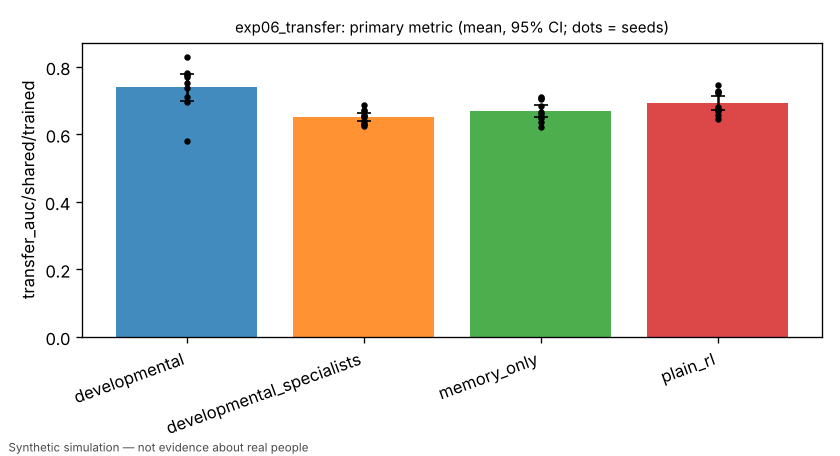
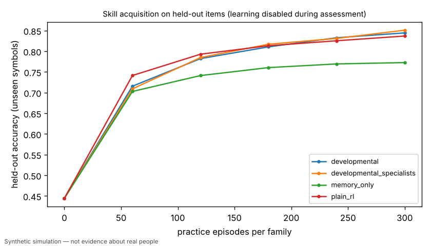
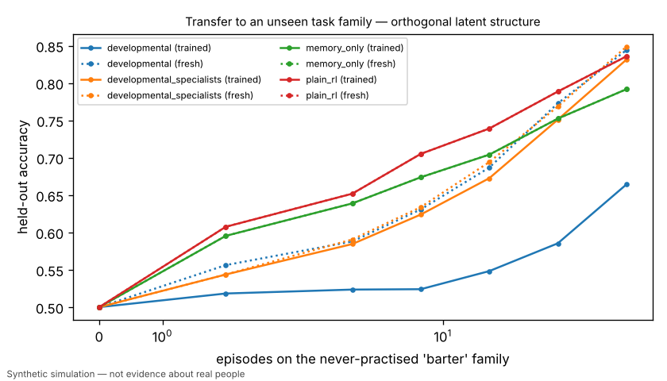
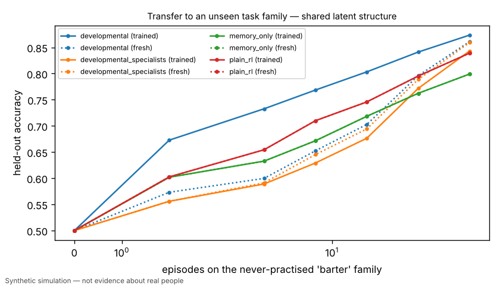

# Exp 6 / H3: transfer to an unseen task family (shared vs orthogonal latent structure)

> Simulated result from a synthetic world. Effects may simply reflect assumptions built into the simulator and are not estimates of real-world causal effects.

- Experiment id: `exp06_transfer`  
- Preregistration hash: `8ea8b2d414bfb432cf8734232d644bb5` (written to definition.json before any run)  
- Protocol: `learning_lab`; seeds: [0, 1, 2, 3, 4, 5, 6, 7, 8, 9]; arms: developmental, developmental_specialists, plain_rl, memory_only  
- Status: **PASSED** — primary contrast 'shared_representation_vs_specialists' (superiority): developmental vs developmental_specialists on transfer_auc/shared/trained: estimate +0.0895 (95% CI [+0.0503, +0.1228], n=10 seeds; relative +13.7%); threshold 0.0300 -> passed

## Hypothesis and falsification criterion

**Hypothesis.** A learner with a shared representation trained on sort/compare/signal adapts faster to the never-practised 'barter' family than independently trained specialists when barter shares the latent structure, and shows no benefit (or negative transfer) when it does not.

**Falsification criterion.** Not supported if the developmental learner's few-shot AUC on barter (shared world) does not exceed the specialist ablation by >= 0.03 with a paired 95% CI excluding 0 across 10 seeds.

**Primary metric.** `transfer_auc/shared/trained` — Mean held-out accuracy on barter across shot counts {0,2,4,8,16,32,64} of bandit-feedback practice, measured on a clone of each trained agent (transfer_probe); mean over 20 agents; one value per seed.

## Arm summaries (mean over seeds, 95% bootstrap CI)

| arm | n seeds | `transfer_auc/shared/trained` | `transfer_gain/shared` | `transfer_auc/orthogonal/trained` | `transfer_gain/orthogonal` | `zero_shot/barter` | `final_heldout_accuracy` |
|---|---|---|---|---|---|---|---|
| developmental | 10 | 0.742 [0.697, 0.777] | 0.072 [0.035, 0.105] | 0.552 [0.542, 0.563] | -0.102 [-0.117, -0.089] | 0.500 [0.500, 0.500] | 0.849 [0.832, 0.868] |
| developmental_specialists | 10 | 0.652 [0.640, 0.664] | -0.010 [-0.012, -0.008] | 0.644 [0.632, 0.655] | -0.010 [-0.012, -0.009] | 0.500 [0.500, 0.500] | 0.852 [0.837, 0.869] |
| memory_only | 10 | 0.669 [0.651, 0.688] | 0.000 [0.000, 0.000] | 0.665 [0.649, 0.682] | 0.000 [0.000, 0.000] | 0.500 [0.500, 0.500] | 0.773 [0.748, 0.799] |
| plain_rl | 10 | 0.692 [0.673, 0.713] | 0.000 [0.000, 0.000] | 0.690 [0.674, 0.706] | 0.000 [0.000, 0.000] | 0.500 [0.500, 0.500] | 0.837 [0.814, 0.861] |

## Preregistered contrasts

| contrast | kind | treatment | control | estimate | 95% CI | relative | p | verdict |
|---|---|---|---|---|---|---|---|---|
| shared_representation_vs_specialists (primary) | superiority | developmental | developmental_specialists | +0.0895 | [+0.0503, +0.1228] | +13.7% | 0.0059 | **passed** |
| shared_vs_plain_rl | superiority | developmental | plain_rl | +0.0493 | [+0.0134, +0.0823] | +7.1% | 0.0371 (Holm) | **passed** |
| transfer_gain_vs_plain_rl | superiority | developmental | plain_rl | +0.0724 | [+0.0361, +0.1063] | +nan% | 0.0156 (Holm) | **passed** |
| orthogonal_control_no_benefit | exploratory | developmental | developmental_specialists | -0.0919 | [-0.1045, -0.0784] | -14.3% | 0.0020 | **exploratory** |
| orthogonal_gain_vs_plain_rl | exploratory | developmental | plain_rl | -0.1021 | [-0.1166, -0.0888] | +nan% | 0.0020 | **exploratory** |

## Contamination checks (from raw logs)

- `leakage/assessment_mutated_policy`: max over runs = 0
- `leakage/holdout_symbols_in_practice`: max over runs = 0
- `leakage/practice_items`: max over runs = 18180

## Figures (regenerated from raw logs)






## Compute

- Runs: 40; total wall time 355.0 s; LLM calls: 0; paid API cost: $0.
- Hardware: x86_64 4 cpu, Linux 6.18.44-fc-v233, python 3.13.18

## Limitations

- Barter is never practised during development; leakage/holdout_symbols_in_practice must be 0.
- Because all rules are linear in the raw features, a shared representation can only help through sample efficiency.
- Simulated result from a synthetic world. Effects may simply reflect assumptions built into the simulator and are not estimates of real-world causal effects.

## Reproduce

```bash
python -m hpe.evaluation run experiments/exp06_transfer.yaml
python -m hpe.evaluation analyze <out>/exp06_transfer   # regenerates result.json from raw logs
```
