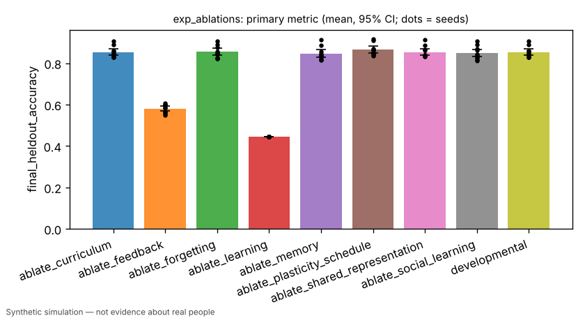
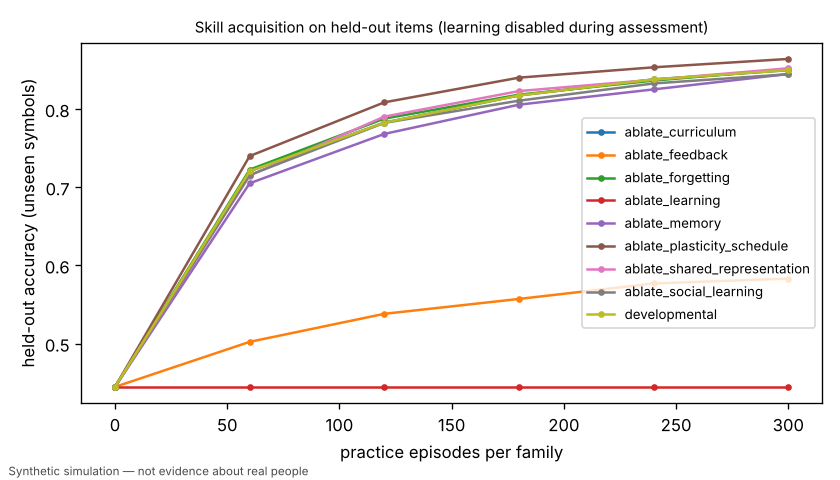
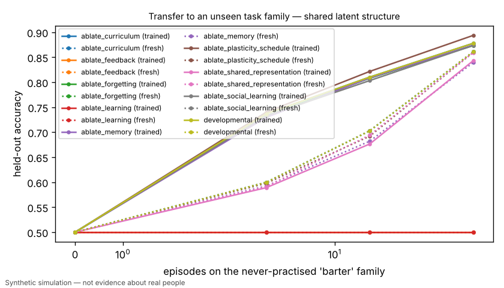

# Ablations: which developmental components produce held-out skill?

> Simulated result from a synthetic world. Effects may simply reflect assumptions built into the simulator and are not estimates of real-world causal effects.

- Experiment id: `exp_ablations`  
- Preregistration hash: `35deebb2c439534ae1b859edf09687e3` (written to definition.json before any run)  
- Protocol: `learning_lab`; seeds: [0, 1, 2, 3, 4, 5, 6, 7, 8, 9]; arms: developmental, ablate_learning, ablate_feedback, ablate_memory, ablate_shared_representation, ablate_social_learning, ablate_plasticity_schedule, ablate_curriculum, ablate_forgetting  
- Status: **PASSED** — primary contrast 'learning_is_necessary' (superiority): developmental vs ablate_learning on final_heldout_accuracy: estimate +0.4086 (95% CI [+0.3947, +0.4255], n=10 seeds; relative +91.9%); threshold 0.1000 -> passed

## Hypothesis and falsification criterion

**Hypothesis.** Held-out skill comes from experience-driven parameter learning, not from scripted age gates: freezing policy learning or withholding feedback removes the gain; other components contribute measurably or not at all.

**Falsification criterion.** The learning claim is refuted if freezing policy learning (ablate_learning) does not reduce held-out accuracy by >= 0.10 with a paired 95% CI excluding 0 — that would mean measured skill comes from scripted mechanisms.

**Primary metric.** `final_heldout_accuracy` — Mean held-out accuracy over training families after 300 episodes/family + 30 teacher demonstrations/family.

## Arm summaries (mean over seeds, 95% bootstrap CI)

| arm | n seeds | `final_heldout_accuracy` | `transfer_auc/shared/trained` | `retention_change` | `final_log_loss` |
|---|---|---|---|---|---|
| ablate_curriculum | 10 | 0.853 [0.839, 0.869] | 0.731 [0.691, 0.763] | -0.007 [-0.011, -0.003] | 0.348 [0.308, 0.384] |
| ablate_feedback | 10 | 0.580 [0.568, 0.592] | 0.500 [0.500, 0.500] | -0.022 [-0.029, -0.015] | 0.765 [0.754, 0.776] |
| ablate_forgetting | 10 | 0.854 [0.838, 0.872] | 0.728 [0.690, 0.759] | 0.000 [0.000, 0.000] | 0.362 [0.313, 0.409] |
| ablate_learning | 10 | 0.444 [0.444, 0.444] | 0.500 [0.500, 0.500] | 0.000 [0.000, 0.000] | 0.828 [0.828, 0.828] |
| ablate_memory | 10 | 0.846 [0.830, 0.865] | 0.728 [0.691, 0.757] | -0.010 [-0.012, -0.006] | 0.377 [0.330, 0.421] |
| ablate_plasticity_schedule | 10 | 0.865 [0.849, 0.882] | 0.739 [0.703, 0.768] | -0.010 [-0.013, -0.008] | 0.313 [0.276, 0.347] |
| ablate_shared_representation | 10 | 0.854 [0.839, 0.871] | 0.652 [0.640, 0.665] | -0.005 [-0.009, -0.000] | 0.352 [0.312, 0.389] |
| ablate_social_learning | 10 | 0.849 [0.832, 0.868] | 0.727 [0.688, 0.758] | -0.007 [-0.011, -0.003] | 0.367 [0.318, 0.411] |
| developmental | 10 | 0.853 [0.839, 0.869] | 0.731 [0.693, 0.764] | -0.007 [-0.011, -0.003] | 0.348 [0.308, 0.383] |

## Preregistered contrasts

| contrast | kind | treatment | control | estimate | 95% CI | relative | p | verdict |
|---|---|---|---|---|---|---|---|---|
| learning_is_necessary (primary) | superiority | developmental | ablate_learning | +0.4086 | [+0.3947, +0.4255] | +91.9% | 0.0020 | **passed** |
| feedback_is_necessary | superiority | developmental | ablate_feedback | +0.2728 | [+0.2604, +0.2854] | +47.0% | 0.0020 (Holm) | **passed** |
| memory_contribution | exploratory | developmental | ablate_memory | +0.0069 | [+0.0028, +0.0112] | +0.8% | 0.0117 | **exploratory** |
| shared_representation_contribution | exploratory | developmental | ablate_shared_representation | +0.0791 | [+0.0451, +0.1072] | +12.1% | 0.0059 | **exploratory** |
| social_learning_contribution | exploratory | developmental | ablate_social_learning | +0.0041 | [-0.0036, +0.0132] | +0.5% | 0.3945 | **exploratory** |
| plasticity_schedule_contribution | exploratory | developmental | ablate_plasticity_schedule | -0.0116 | [-0.0154, -0.0077] | -1.3% | 0.0020 | **exploratory** |
| curriculum_contribution | exploratory | developmental | ablate_curriculum | +0.0000 | [+0.0000, +0.0000] | +0.0% | 1.0000 | **exploratory** |
| forgetting_effect_on_retention | exploratory | developmental | ablate_forgetting | -0.0067 | [-0.0106, -0.0027] | +nan% | 0.0117 | **exploratory** |

## Ablations (ablated arm minus full learner, primary metric)

| ablation | estimate | 95% CI | n |
|---|---|---|---|
| ablate_learning | -0.4086 | [-0.4250, -0.3941] | 10 |
| ablate_feedback | -0.2728 | [-0.2862, -0.2600] | 10 |
| ablate_memory | -0.0069 | [-0.0111, -0.0029] | 10 |
| ablate_shared_representation | +0.0006 | [-0.0040, +0.0049] | 10 |
| ablate_social_learning | -0.0041 | [-0.0126, +0.0037] | 10 |
| ablate_plasticity_schedule | +0.0116 | [+0.0079, +0.0156] | 10 |
| ablate_curriculum | +0.0000 | [+0.0000, +0.0000] | 10 |
| ablate_forgetting | +0.0012 | [-0.0031, +0.0064] | 10 |

## Contamination checks (from raw logs)

- `leakage/assessment_mutated_policy`: max over runs = 0
- `leakage/holdout_symbols_in_practice`: max over runs = 0
- `leakage/practice_items`: max over runs = 19980

## Figures (regenerated from raw logs)





## Compute

- Runs: 90; total wall time 419.7 s; LLM calls: 0; paid API cost: $0.
- Hardware: x86_64 4 cpu, Linux 6.18.44-fc-v233, python 3.13.18

## Limitations

- Curriculum only affects self-directed practice choice; in this fixed-schedule lab it may have no effect by design.
- Ablation flags are implemented by the research/development lane; this experiment only toggles them.
- Simulated result from a synthetic world. Effects may simply reflect assumptions built into the simulator and are not estimates of real-world causal effects.

## Reproduce

```bash
python -m hpe.evaluation run experiments/exp_ablations.yaml
python -m hpe.evaluation analyze <out>/exp_ablations   # regenerates result.json from raw logs
```
