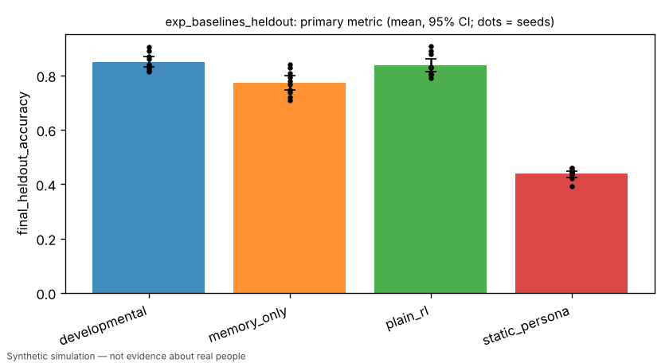
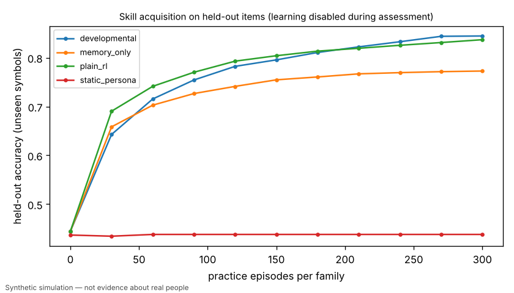
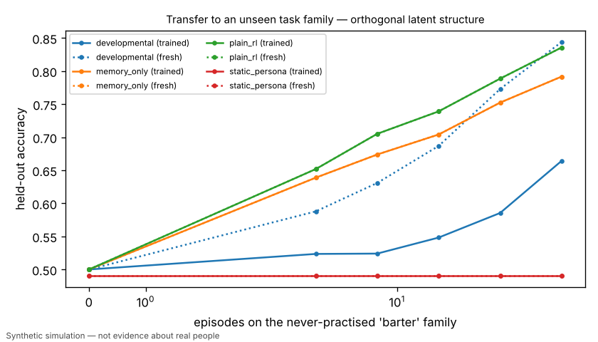
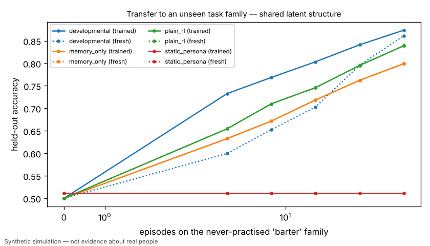

# H1: developmental learner vs static persona, memory-only and plain-RL baselines on held-out tasks

> Simulated result from a synthetic world. Effects may simply reflect assumptions built into the simulator and are not estimates of real-world causal effects.

- Experiment id: `exp_baselines_heldout`  
- Preregistration hash: `a2c3efe591fa8df730ccba91c97485f1` (written to definition.json before any run)  
- Protocol: `learning_lab`; seeds: [0, 1, 2, 3, 4, 5, 6, 7, 8, 9]; arms: static_persona, memory_only, plain_rl, developmental  
- Status: **FAILED** — primary contrast 'developmental_vs_strongest_baseline' (superiority): developmental vs plain_rl on final_heldout_accuracy: estimate +0.0121 (95% CI [-0.0080, +0.0306], n=10 seeds; relative +1.4%); threshold 0.0837 -> failed; control = strongest of memory_only=0.7727, plain_rl=0.8369, static_persona=0.4381 -> plain_rl

## Hypothesis and falsification criterion

**Hypothesis.** Agents whose policy develops from experience (developmental learner) reach higher accuracy on held-out symbols (never seen in practice) than equally-resourced static-persona, memory-only, or plain-RL agents given an identical item and feedback stream.

**Falsification criterion.** H1 is NOT supported if the developmental learner's mean held-out accuracy fails to exceed the strongest baseline by >=10% (relative) with a paired 95% bootstrap CI excluding zero across 10 independent seeds; it is refuted (failed) if the CI upper bound lies below the 10% threshold.

**Primary metric.** `final_heldout_accuracy` — Per agent: mean over the three training families (sort, compare, signal) of greedy accuracy on the fixed 60-item held-out set (holdout symbols only, learning disabled, ties credited fractionally) after 300 practice episodes per family; averaged over 20 agents per seed; one value per seed.

## Arm summaries (mean over seeds, 95% bootstrap CI)

| arm | n seeds | `final_heldout_accuracy` | `final_log_loss` | `heldout_ece` | `generalization_gap` | `retention_change` | `zero_shot/barter` | `transfer_auc/shared/trained` | `transfer_gain/shared` | `transfer_gain/orthogonal` | `self_estimate_gap` |
|---|---|---|---|---|---|---|---|---|---|---|---|
| developmental | 10 | 0.849 [0.831, 0.868] | 0.367 [0.319, 0.413] | 0.108 [0.097, 0.118] | 0.055 [0.037, 0.073] | -0.007 [-0.011, -0.003] | 0.500 [0.500, 0.500] | 0.753 [0.710, 0.788] | 0.068 [0.032, 0.101] | -0.113 [-0.127, -0.100] | -0.055 [-0.072, -0.038] |
| memory_only | 10 | 0.773 [0.746, 0.799] | 0.573 [0.531, 0.616] | 0.173 [0.168, 0.180] | 0.170 [0.145, 0.196] | 0.000 [0.000, 0.000] | 0.500 [0.500, 0.500] | 0.681 [0.661, 0.700] | 0.000 [0.000, 0.000] | 0.000 [0.000, 0.000] | 0.054 [0.029, 0.079] |
| plain_rl | 10 | 0.837 [0.815, 0.863] | 0.383 [0.341, 0.419] | 0.128 [0.120, 0.135] | 0.080 [0.063, 0.095] | 0.000 [0.000, 0.000] | 0.500 [0.500, 0.500] | 0.707 [0.687, 0.730] | 0.000 [0.000, 0.000] | 0.000 [0.000, 0.000] | -0.081 [-0.102, -0.064] |
| static_persona | 10 | 0.438 [0.425, 0.449] | 2.905 [2.768, 3.070] | 0.483 [0.470, 0.499] | 0.005 [-0.004, 0.013] | 0.000 [0.000, 0.000] | 0.511 [0.495, 0.525] | 0.511 [0.495, 0.525] | 0.000 [0.000, 0.000] | 0.000 [0.000, 0.000] | — |

## Preregistered contrasts

| contrast | kind | treatment | control | estimate | 95% CI | relative | p | verdict |
|---|---|---|---|---|---|---|---|---|
| developmental_vs_strongest_baseline (primary) | superiority | developmental | plain_rl | +0.0121 | [-0.0080, +0.0306] | +1.4% | 0.3164 | **failed** |
| calibration_not_degraded | non_inferiority | developmental | plain_rl | -0.0163 | [-0.0523, +0.0215] | +4.3% | CI vs margin 0.05 | **passed** |
| developmental_vs_plain_rl | superiority | developmental | plain_rl | +0.0121 | [-0.0084, +0.0312] | +1.4% | 0.3164 (Holm) | **inconclusive** |
| developmental_vs_memory_only | superiority | developmental | memory_only | +0.0763 | [+0.0564, +0.0963] | +9.9% | 0.0059 (Holm) | **passed** |
| developmental_vs_static_persona | superiority | developmental | static_persona | +0.4109 | [+0.3915, +0.4323] | +93.8% | 0.0059 (Holm) | **passed** |
| memory_only_vs_static_persona | exploratory | memory_only | static_persona | +0.3346 | [+0.3037, +0.3659] | +76.4% | 0.0020 | **exploratory** |
| practice_efficiency_vs_plain_rl | exploratory | developmental | plain_rl | +9.0000 | [+4.6500, +13.6500] | -24.9% | 0.0078 | **exploratory** |

## Sensitivity analyses

| variant | params | contrast | estimate | 95% CI | verdict |
|---|---|---|---|---|---|
| bandit_only_feedback | `{"full_feedback_fraction": 0.0}` | developmental_vs_strongest_baseline | +0.0369 | [+0.0195, +0.0536] | failed |
| high_label_noise | `{"label_noise": 0.15}` | developmental_vs_strongest_baseline | -0.0456 | [-0.0617, -0.0301] | failed |
| low_data_100_episodes | `{"checkpoint_every": 20, "episodes_per_family": 100}` | developmental_vs_strongest_baseline | -0.0050 | [-0.0234, +0.0123] | failed |
| no_age_gate | `{"enable_gate": false}` | developmental_vs_strongest_baseline | +0.0169 | [+0.0010, +0.0324] | failed |

## Contamination checks (from raw logs)

- `leakage/assessment_mutated_policy`: max over runs = 0
- `leakage/holdout_symbols_in_practice`: max over runs = 0
- `leakage/practice_items`: max over runs = 18180

## Figures (regenerated from raw logs)






## Compute

- Runs: 200; total wall time 1315.5 s; LLM calls: 0; paid API cost: $0.
- Hardware: x86_64 4 cpu, Linux 6.18.44-fc-v233, python 3.13.18

## Limitations

- Synthetic task world; held-out = unseen symbols under the same hidden rules, not unseen humans.
- Baseline hyperparameters (plain_rl lr=0.05) were tuned on task seeds 1001-1003, never on evaluation seeds 0-9.
- The developmental learner's hyperparameters are owned by the research/development lane; if they were tuned on evaluation seeds this result is optimistic.
- Age gate (perceptual feature access) is a scripted assumption applied identically to all arms; the no_age_gate sensitivity variant removes it.
- Simulated result from a synthetic world. Effects may simply reflect assumptions built into the simulator and are not estimates of real-world causal effects.

## Reproduce

```bash
python -m hpe.evaluation run experiments/exp_baselines_heldout.yaml
python -m hpe.evaluation analyze <out>/exp_baselines_heldout   # regenerates result.json from raw logs
```
