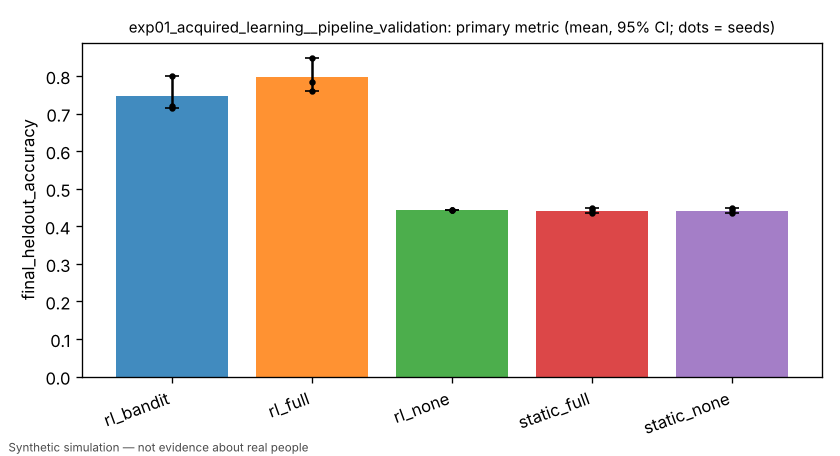
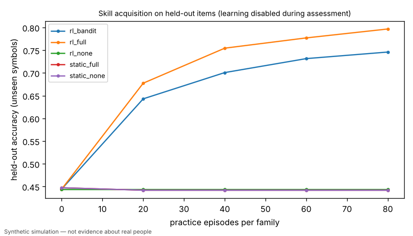
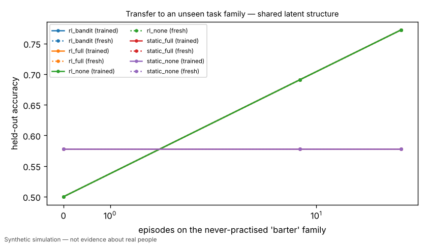

# [PIPELINE VALIDATION] Exp 1: acquired learning — identical agents randomised to none / outcome / instructional feedback

> **PIPELINE VALIDATION RUN** — scaled-down budget/seeds to validate code paths. Not a research result.

> Simulated result from a synthetic world. Effects may simply reflect assumptions built into the simulator and are not estimates of real-world causal effects.

- Experiment id: `exp01_acquired_learning__pipeline_validation`  
- Preregistration hash: `a9e44777059d1d3e97e4a72bacd6fe18` (written to definition.json before any run)  
- Protocol: `learning_lab`; seeds: [0, 1, 2]; arms: dev_none, dev_bandit, dev_full, dev_none_frozen, rl_none, rl_bandit, rl_full, static_none, static_full  
- Status: **INCONCLUSIVE** — primary contrast not computed: no data for arm(s) ['dev_full', 'dev_none']

## Hypothesis and falsification criterion

**Hypothesis.** Identical initial agents acquire held-out skill as a function of the feedback they receive: instructional (full) feedback > outcome-only (bandit) feedback > no feedback, and a non-learning persona shows no effect.

**Falsification criterion.** Not supported if dev_full fails to exceed dev_none by >= 0.05 held-out accuracy with the paired 95% CI excluding 0 across 10 seeds. The mechanism check fails if static_full and static_none differ by more than 0.02.

**Primary metric.** `final_heldout_accuracy` — Mean held-out accuracy over training families after 300 episodes/family; mean over 20 agents; one value per seed.

## Arm summaries (mean over seeds, 95% bootstrap CI)

| arm | n seeds | `final_heldout_accuracy` | `episodes_to_criterion/compare` | `retention_change` | `final_log_loss` | `transfer_auc/shared/trained` |
|---|---|---|---|---|---|---|
| rl_bandit | 3 | 0.746 [0.716, 0.801] | 37.333 [24.000, 56.000] | 0.000 [0.000, 0.000] | 0.574 [0.534, 0.614] | 0.654 [0.621, 0.708] |
| rl_full | 3 | 0.797 [0.759, 0.847] | 30.667 [20.000, 40.000] | 0.000 [0.000, 0.000] | 0.491 [0.441, 0.521] | 0.654 [0.621, 0.708] |
| rl_none | 3 | 0.444 [0.444, 0.444] | 160.000 [160.000, 160.000] | 0.000 [0.000, 0.000] | 0.828 [0.828, 0.828] | 0.654 [0.621, 0.708] |
| static_full | 3 | 0.442 [0.436, 0.448] | 150.667 [132.000, 160.000] | 0.000 [0.000, 0.000] | 2.764 [2.701, 2.874] | 0.578 [0.560, 0.600] |
| static_none | 3 | 0.442 [0.436, 0.448] | 150.667 [132.000, 160.000] | 0.000 [0.000, 0.000] | 2.764 [2.701, 2.874] | 0.578 [0.560, 0.600] |

## Preregistered contrasts

| contrast | kind | treatment | control | estimate | 95% CI | relative | p | verdict |
|---|---|---|---|---|---|---|---|---|
| instruction_vs_no_feedback_developmental (primary) | superiority | dev_full | dev_none | — | — | — | — | not_computed: no data for arm(s) ['dev_full', 'dev_none'] |
| outcome_feedback_vs_none_developmental | superiority | dev_bandit | dev_none | — | — | — | — | not_computed: no data for arm(s) ['dev_bandit', 'dev_none'] |
| instruction_vs_outcome_efficiency_developmental | superiority | dev_full | dev_bandit | — | — | — | — | not_computed: no data for arm(s) ['dev_full', 'dev_bandit'] |
| no_feedback_learning_is_null_developmental | equivalence | dev_none | dev_none_frozen | — | — | — | — | not_computed: no data for arm(s) ['dev_none', 'dev_none_frozen'] |
| instruction_vs_no_feedback_plain_rl | superiority | rl_full | rl_none | +0.3522 | [+0.3144, +0.4022] | +79.2% | 0.2500 (Holm) | **passed** |
| mechanism_check_static_persona | equivalence | static_full | static_none | +0.0000 | [+0.0000, +0.0000] | +0.0% | CI vs margin 0.02 | **passed** |
| retention_developmental_full | exploratory | dev_full | rl_full | — | — | — | — | not_computed: no data for arm(s) ['dev_full'] |

## Contamination checks (from raw logs)

- `leakage/assessment_mutated_policy`: max over runs = 0
- `leakage/holdout_symbols_in_practice`: max over runs = 0
- `leakage/practice_items`: max over runs = 1380

## Figures (regenerated from raw logs)





## Compute

- Runs: 15; total wall time 24.5 s; LLM calls: 0; paid API cost: $0.
- Hardware: x86_64 4 cpu, Linux 6.18.44-fc-v233, python 3.13.18

## Limitations

- PIPELINE VALIDATION RUN: scaled-down budget and seeds; not the preregistered experiment. Do not cite as a research result.
- Feedback conditions are properties of the synthetic environment; 'instruction' here means revealing the correct answer, not human teaching.
- Retention measures forgetting dynamics built into each policy class (baselines do not forget by construction).
- Arm 'dev_bandit' was NOT run: policy class 'developmental' not registered in this build (KeyError: "no policy registered for 'developmental'; known: ['memory_only', 'plain_rl', 'random', 'static_persona']").
- Arm 'dev_full' was NOT run: policy class 'developmental' not registered in this build (KeyError: "no policy registered for 'developmental'; known: ['memory_only', 'plain_rl', 'random', 'static_persona']").
- Arm 'dev_none' was NOT run: policy class 'developmental' not registered in this build (KeyError: "no policy registered for 'developmental'; known: ['memory_only', 'plain_rl', 'random', 'static_persona']").
- Arm 'dev_none_frozen' was NOT run: policy class 'developmental' not registered in this build (KeyError: "no policy registered for 'developmental'; known: ['memory_only', 'plain_rl', 'random', 'static_persona']").
- Simulated result from a synthetic world. Effects may simply reflect assumptions built into the simulator and are not estimates of real-world causal effects.

## Reproduce

```bash
python -m hpe.evaluation run experiments/exp01_acquired_learning.yaml --pipeline-validation
python -m hpe.evaluation analyze <out>/exp01_acquired_learning__pipeline_validation   # regenerates result.json from raw logs
```
