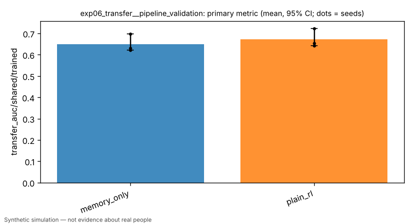
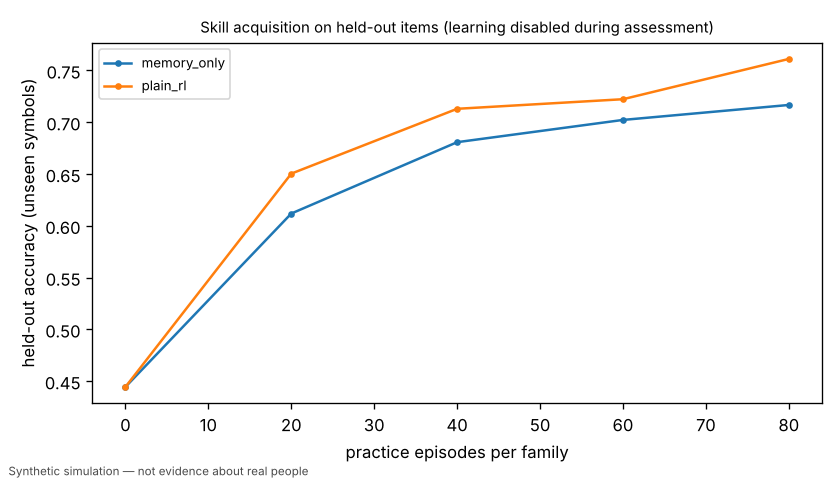
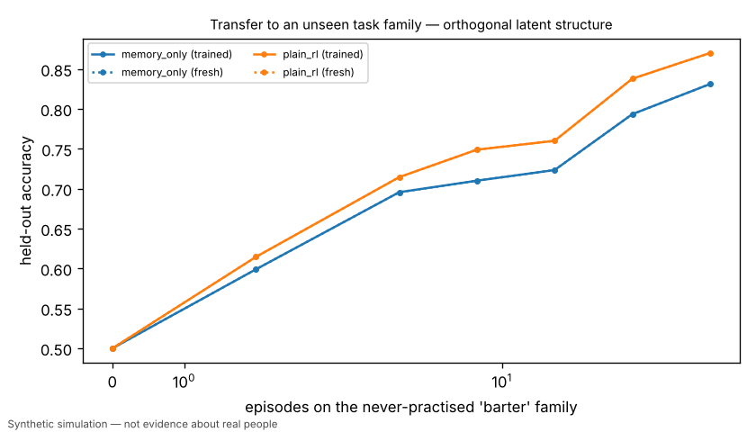
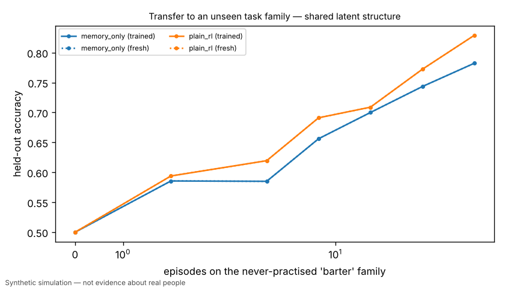

# [PIPELINE VALIDATION] Exp 6 / H3: transfer to an unseen task family (shared vs orthogonal latent structure)

> **PIPELINE VALIDATION RUN** — scaled-down budget/seeds to validate code paths. Not a research result.

> Simulated result from a synthetic world. Effects may simply reflect assumptions built into the simulator and are not estimates of real-world causal effects.

- Experiment id: `exp06_transfer__pipeline_validation`  
- Preregistration hash: `c7c139d88580bb42932160e44925d2f6` (written to definition.json before any run)  
- Protocol: `learning_lab`; seeds: [0, 1, 2]; arms: developmental, developmental_specialists, plain_rl, memory_only  
- Status: **INCONCLUSIVE** — primary contrast not computed: no data for arm(s) ['developmental', 'developmental_specialists']

## Hypothesis and falsification criterion

**Hypothesis.** A learner with a shared representation trained on sort/compare/signal adapts faster to the never-practised 'barter' family than independently trained specialists when barter shares the latent structure, and shows no benefit (or negative transfer) when it does not.

**Falsification criterion.** Not supported if the developmental learner's few-shot AUC on barter (shared world) does not exceed the specialist ablation by >= 0.03 with a paired 95% CI excluding 0 across 10 seeds.

**Primary metric.** `transfer_auc/shared/trained` — Mean held-out accuracy on barter across shot counts {0,2,4,8,16,32,64} of bandit-feedback practice, measured on a clone of each trained agent (transfer_probe); mean over 20 agents; one value per seed.

## Arm summaries (mean over seeds, 95% bootstrap CI)

| arm | n seeds | `transfer_auc/shared/trained` | `transfer_gain/shared` | `transfer_auc/orthogonal/trained` | `transfer_gain/orthogonal` | `zero_shot/barter` | `final_heldout_accuracy` |
|---|---|---|---|---|---|---|---|
| memory_only | 3 | 0.650 [0.621, 0.698] | 0.000 [0.000, 0.000] | 0.693 [0.691, 0.696] | 0.000 [0.000, 0.000] | 0.500 [0.500, 0.500] | 0.717 [0.686, 0.766] |
| plain_rl | 3 | 0.673 [0.643, 0.723] | 0.000 [0.000, 0.000] | 0.721 [0.708, 0.731] | 0.000 [0.000, 0.000] | 0.500 [0.500, 0.500] | 0.761 [0.732, 0.807] |

## Preregistered contrasts

| contrast | kind | treatment | control | estimate | 95% CI | relative | p | verdict |
|---|---|---|---|---|---|---|---|---|
| shared_representation_vs_specialists (primary) | superiority | developmental | developmental_specialists | — | — | — | — | not_computed: no data for arm(s) ['developmental', 'developmental_specialists'] |
| shared_vs_plain_rl | superiority | developmental | plain_rl | — | — | — | — | not_computed: no data for arm(s) ['developmental'] |
| transfer_gain_vs_plain_rl | superiority | developmental | plain_rl | — | — | — | — | not_computed: no data for arm(s) ['developmental'] |
| orthogonal_control_no_benefit | exploratory | developmental | developmental_specialists | — | — | — | — | not_computed: no data for arm(s) ['developmental', 'developmental_specialists'] |
| orthogonal_gain_vs_plain_rl | exploratory | developmental | plain_rl | — | — | — | — | not_computed: no data for arm(s) ['developmental'] |

## Contamination checks (from raw logs)

- `leakage/assessment_mutated_policy`: max over runs = 0
- `leakage/holdout_symbols_in_practice`: max over runs = 0
- `leakage/practice_items`: max over runs = 1380

## Figures (regenerated from raw logs)






## Compute

- Runs: 6; total wall time 10.4 s; LLM calls: 0; paid API cost: $0.
- Hardware: x86_64 4 cpu, Linux 6.18.44-fc-v233, python 3.13.18

## Limitations

- PIPELINE VALIDATION RUN: scaled-down budget and seeds; not the preregistered experiment. Do not cite as a research result.
- Barter is never practised during development; leakage/holdout_symbols_in_practice must be 0.
- Because all rules are linear in the raw features, a shared representation can only help through sample efficiency.
- Arm 'developmental' was NOT run: policy class 'developmental' not registered in this build (KeyError: "no policy registered for 'developmental'; known: ['memory_only', 'plain_rl', 'random', 'static_persona']").
- Arm 'developmental_specialists' was NOT run: policy class 'developmental' not registered in this build (KeyError: "no policy registered for 'developmental'; known: ['memory_only', 'plain_rl', 'random', 'static_persona']").
- Simulated result from a synthetic world. Effects may simply reflect assumptions built into the simulator and are not estimates of real-world causal effects.

## Reproduce

```bash
python -m hpe.evaluation run experiments/exp06_transfer.yaml --pipeline-validation
python -m hpe.evaluation analyze <out>/exp06_transfer__pipeline_validation   # regenerates result.json from raw logs
```
