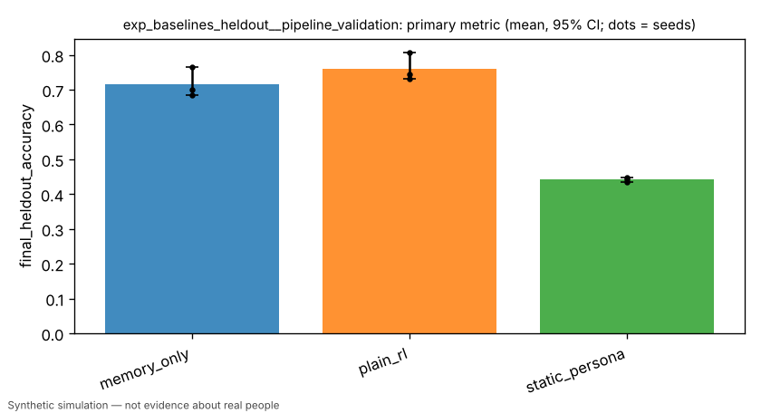
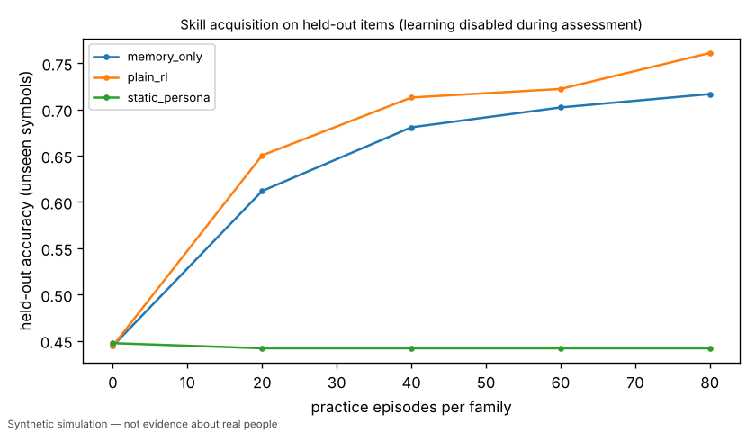
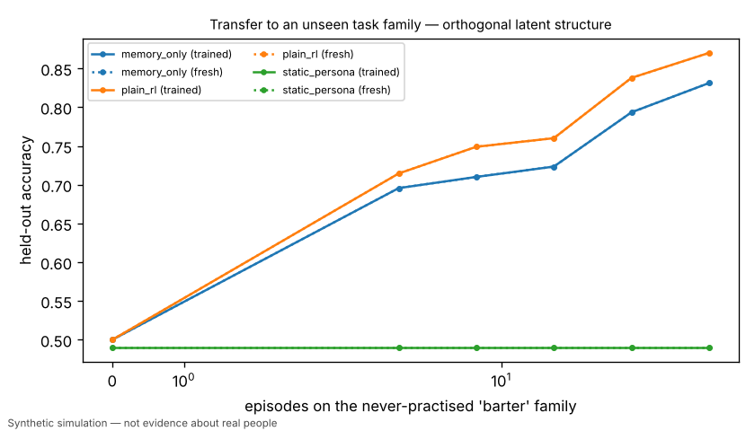
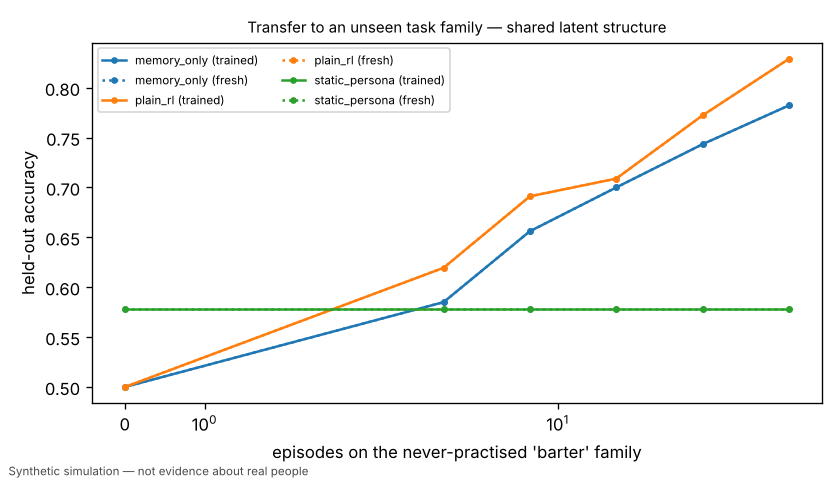

# [PIPELINE VALIDATION] H1: developmental learner vs static persona, memory-only and plain-RL baselines on held-out tasks

> **PIPELINE VALIDATION RUN** — scaled-down budget/seeds to validate code paths. Not a research result.

> Simulated result from a synthetic world. Effects may simply reflect assumptions built into the simulator and are not estimates of real-world causal effects.

- Experiment id: `exp_baselines_heldout__pipeline_validation`  
- Preregistration hash: `ef3112ea0d2cc207781de211ac258690` (written to definition.json before any run)  
- Protocol: `learning_lab`; seeds: [0, 1, 2]; arms: static_persona, memory_only, plain_rl, developmental  
- Status: **INCONCLUSIVE** — primary contrast not computed: no data for arm(s) ['developmental']

## Hypothesis and falsification criterion

**Hypothesis.** Agents whose policy develops from experience (developmental learner) reach higher accuracy on held-out symbols (never seen in practice) than equally-resourced static-persona, memory-only, or plain-RL agents given an identical item and feedback stream.

**Falsification criterion.** H1 is NOT supported if the developmental learner's mean held-out accuracy fails to exceed the strongest baseline by >=10% (relative) with a paired 95% bootstrap CI excluding zero across 10 independent seeds; it is refuted (failed) if the CI upper bound lies below the 10% threshold.

**Primary metric.** `final_heldout_accuracy` — Per agent: mean over the three training families (sort, compare, signal) of greedy accuracy on the fixed 60-item held-out set (holdout symbols only, learning disabled, ties credited fractionally) after 300 practice episodes per family; averaged over 20 agents per seed; one value per seed.

## Arm summaries (mean over seeds, 95% bootstrap CI)

| arm | n seeds | `final_heldout_accuracy` | `final_log_loss` | `heldout_ece` | `generalization_gap` | `retention_change` | `zero_shot/barter` | `transfer_auc/shared/trained` | `transfer_gain/shared` | `transfer_gain/orthogonal` | `self_estimate_gap` |
|---|---|---|---|---|---|---|---|---|---|---|---|
| memory_only | 3 | 0.717 [0.686, 0.766] | 0.717 [0.671, 0.745] | 0.202 [0.188, 0.225] | 0.117 [0.048, 0.154] | 0.000 [0.000, 0.000] | 0.500 [0.500, 0.500] | 0.661 [0.630, 0.715] | 0.000 [0.000, 0.000] | 0.000 [0.000, 0.000] | -0.118 [-0.139, -0.096] |
| plain_rl | 3 | 0.761 [0.732, 0.807] | 0.550 [0.497, 0.592] | 0.157 [0.151, 0.167] | 0.077 [0.039, 0.100] | 0.000 [0.000, 0.000] | 0.500 [0.500, 0.500] | 0.687 [0.650, 0.743] | 0.000 [0.000, 0.000] | 0.000 [0.000, 0.000] | -0.148 [-0.203, -0.094] |
| static_persona | 3 | 0.442 [0.436, 0.448] | 2.764 [2.701, 2.874] | 0.474 [0.461, 0.485] | 0.013 [-0.000, 0.021] | 0.000 [0.000, 0.000] | 0.578 [0.560, 0.600] | 0.578 [0.560, 0.600] | 0.000 [0.000, 0.000] | 0.000 [0.000, 0.000] | — |

## Preregistered contrasts

| contrast | kind | treatment | control | estimate | 95% CI | relative | p | verdict |
|---|---|---|---|---|---|---|---|---|
| developmental_vs_strongest_baseline (primary) | superiority | developmental | plain_rl | — | — | — | — | not_computed: no data for arm(s) ['developmental'] |
| calibration_not_degraded | non_inferiority | developmental | plain_rl | — | — | — | — | not_computed: no data for arm(s) ['developmental'] |
| developmental_vs_plain_rl | superiority | developmental | plain_rl | — | — | — | — | not_computed: no data for arm(s) ['developmental'] |
| developmental_vs_memory_only | superiority | developmental | memory_only | — | — | — | — | not_computed: no data for arm(s) ['developmental'] |
| developmental_vs_static_persona | superiority | developmental | static_persona | — | — | — | — | not_computed: no data for arm(s) ['developmental'] |
| memory_only_vs_static_persona | exploratory | memory_only | static_persona | +0.2748 | [+0.2500, +0.3233] | +62.2% | 0.2500 | **exploratory** |
| practice_efficiency_vs_plain_rl | exploratory | developmental | plain_rl | — | — | — | — | not_computed: no data for arm(s) ['developmental'] |

## Sensitivity analyses

| variant | params | contrast | estimate | 95% CI | verdict |
|---|---|---|---|---|---|
| high_label_noise | `{"label_noise": 0.15}` | developmental_vs_strongest_baseline | — | — | not_computed |

## Contamination checks (from raw logs)

- `leakage/assessment_mutated_policy`: max over runs = 0
- `leakage/holdout_symbols_in_practice`: max over runs = 0
- `leakage/practice_items`: max over runs = 1380

## Figures (regenerated from raw logs)






## Compute

- Runs: 18; total wall time 50.0 s; LLM calls: 0; paid API cost: $0.
- Hardware: x86_64 4 cpu, Linux 6.18.44-fc-v233, python 3.13.18

## Limitations

- PIPELINE VALIDATION RUN: scaled-down budget and seeds; not the preregistered experiment. Do not cite as a research result.
- Synthetic task world; held-out = unseen symbols under the same hidden rules, not unseen humans.
- Baseline hyperparameters (plain_rl lr=0.05) were tuned on task seeds 1001-1003, never on evaluation seeds 0-9.
- The developmental learner's hyperparameters are owned by the research/development lane; if they were tuned on evaluation seeds this result is optimistic.
- Age gate (perceptual feature access) is a scripted assumption applied identically to all arms; the no_age_gate sensitivity variant removes it.
- Arm 'developmental' was NOT run: policy class 'developmental' not registered in this build (KeyError: "no policy registered for 'developmental'; known: ['memory_only', 'plain_rl', 'random', 'static_persona']").
- Simulated result from a synthetic world. Effects may simply reflect assumptions built into the simulator and are not estimates of real-world causal effects.

## Reproduce

```bash
python -m hpe.evaluation run experiments/exp_baselines_heldout.yaml --pipeline-validation
python -m hpe.evaluation analyze <out>/exp_baselines_heldout__pipeline_validation   # regenerates result.json from raw logs
```
