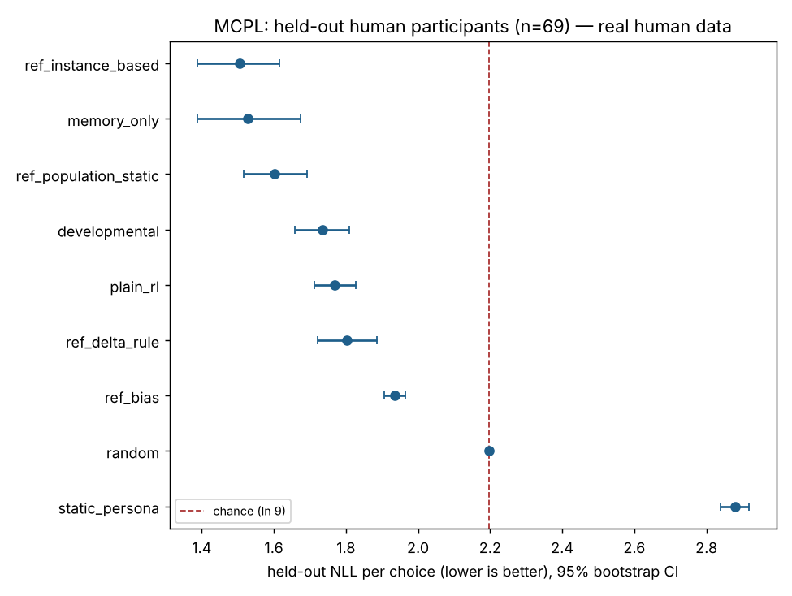
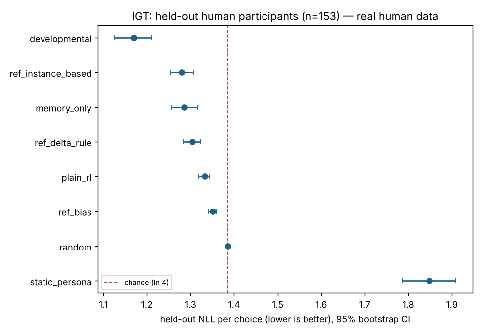

# exp07_human_heldout — Do our policy classes predict held-out human learning choices (Psych-101 MCPL and IGT)?

> Result on real, externally sourced human data (Psych-101, Apache-2.0; Binz et al. 2024). It measures held-out one-step-ahead predictive fit to adult choices in short laboratory learning tasks. It is not a validation of the simulator's world, not a causal claim, and not evidence about any individual's future.

* Preregistration hash: `f30610430c3b847f` (definition committed before analysis)
* **Status: FAILED** — Primary contrast developmental - ref_instance_based on held-out MCPL participants: +0.2289 nats/choice (95% CI [+0.1708, +0.2890], n=69); minimum effect of interest 0.02 nats/choice; rule: passed if ci_high < 0 and estimate <= -0.02; failed if ci_low > -0.02; inconclusive otherwise, or if the developmental class is not available in the build.
* Generated from: fits.json + outcomes.jsonl.gz (derived per-participant held-out metrics); code version `d3e343c3f00efb7f8fc09e932bd469205f8aa653`; wall time 2654.3 s; LLM calls: 0
* Registered policy classes in this build: developmental, memory_only, plain_rl, random, static_persona
* Dataset: Binz, M. et al. (2024). Centaur: a foundation model of human cognition. arXiv:2410.20268 — licence Apache-2.0 (inherited from Psych-101) (derived from PSYCH101_FULL); sha256 `9b085cfbd5506162ae4925b5ca05b3fcb76a69b885395b126d8aa78cf2330297`

## Hypothesis and falsification

A developmental learner (Tier-2 policy, hpe.development) predicts held-out human choices in multiple-cue probability learning better than the strongest non-developmental model, including static models fitted to other participants and the memory-only / plain-RL baselines.

Falsification: The hypothesis fails if the paired 95% bootstrap CI over held-out participants for (developmental NLL - best non-developmental NLL) excludes improvements of at least 0.02 nats per choice (ci_low > -0.02), or if the developmental learner is worse (ci_low > 0).

Primary metric: Mean over held-out MCPL participants of each participant's mean negative log-likelihood (natural log) of their actual choices under teacher forcing, after lapse mixing. Lower is better. Chance = ln 9 = 2.1972 (MCPL), ln 4 = 1.3863 (IGT).

## MCPL — split seed 20261104 (primary split); 163 train / 69 held-out participants

Chance NLL = 2.1972. Best on TRAIN: non-developmental = `ref_instance_based`, adaptive = `ref_instance_based`, static = `ref_population_static`.

| model | status | train NLL | held-out NLL [95% CI] | vs chance | top-1 acc | fitted params | lapse |
|---|---|---|---|---|---|---|---|
| ref_instance_based | ok | 1.5304 | 1.5052 [1.3876, 1.6162] | -0.6920 | 0.566 | `{'h': 0.5, 'kappa': 0.05, 's': 0.5}` | 0.1 |
| memory_only | ok | 1.5410 | 1.5288 [1.3877, 1.6744] | -0.6684 | 0.565 | `{}` | 0.3 |
| ref_population_static | ok | 1.6101 | 1.6023 [1.5158, 1.6927] | -0.5950 | 0.385 | `{'smoothing': 0.5}` | 0.01 |
| developmental | ok | 1.7431 | 1.7342 [1.6594, 1.8099] | -0.4631 | 0.388 | `{}` | 0.3 |
| plain_rl | ok | 1.7712 | 1.7699 [1.7132, 1.8283] | -0.4274 | 0.322 | `{}` | 0.05 |
| ref_delta_rule | ok | 1.8238 | 1.8020 [1.7219, 1.8858] | -0.3952 | 0.448 | `{'alpha': 0.03, 'sigma': 1.0}` | 0.3 |
| ref_bias | ok | 1.9287 | 1.9363 [1.9067, 1.9652] | -0.2609 | 0.292 | `{'smoothing': 1.0}` | 0.0 |
| random | ok | 2.1972 | 2.1972 [2.1972, 2.1972] | -0.0000 | 0.111 | `{}` | 0.0 |
| static_persona | ok | 2.8209 | 2.8787 [2.8400, 2.9170] | +0.6815 | 0.098 | `{}` | 0.3 |

| contrast (NLL difference; negative favours first) | estimate [95% CI] | p | dz | n | status |
|---|---|---|---|---|---|
| developmental - ref_instance_based (primary) | +0.2289 [+0.1708, +0.2890] | ≤0.0005 (bootstrap floor) | 0.91 | 69 | failed |
| ref_instance_based - ref_population_static (best_adaptive - best_static) | -0.0970 [-0.1359, -0.0545] | ≤0.0005 (bootstrap floor) | -0.54 | 69 | passed |

## IGT — split seed 20261104 (primary split); 358 train / 153 held-out participants

Chance NLL = 1.3863. Best on TRAIN: non-developmental = `ref_instance_based`, adaptive = `developmental`, static = `ref_bias`.

| model | status | train NLL | held-out NLL [95% CI] | vs chance | top-1 acc | fitted params | lapse |
|---|---|---|---|---|---|---|---|
| developmental | ok | 1.1714 | 1.1707 [1.1266, 1.2098] | -0.2156 | 0.462 | `{'igt_reward_scale': 250.0}` | 0.0 |
| ref_instance_based | ok | 1.2744 | 1.2809 [1.2532, 1.3066] | -0.1054 | 0.387 | `{'beta': 6.0, 'decay': 0.5, 'igt_reward_scale': 250.0}` | 0.3 |
| memory_only | ok | 1.2934 | 1.2860 [1.2550, 1.3160] | -0.1003 | 0.429 | `{'igt_reward_scale': 500.0}` | 0.3 |
| ref_delta_rule | ok | 1.3005 | 1.3041 [1.2843, 1.3239] | -0.0822 | 0.378 | `{'alpha': 0.4, 'beta': 6.0, 'igt_reward_scale': 250.0}` | 0.2 |
| plain_rl | ok | 1.3301 | 1.3321 [1.3194, 1.3440] | -0.0542 | 0.395 | `{'igt_reward_scale': 500.0}` | 0.0 |
| ref_bias | ok | 1.3474 | 1.3504 [1.3410, 1.3593] | -0.0359 | 0.304 | `{'igt_reward_scale': 250.0, 'smoothing': 1.0}` | 0.01 |
| random | ok | 1.3863 | 1.3863 [1.3863, 1.3863] | +0.0000 | 0.250 | `{'igt_reward_scale': 250.0}` | 0.0 |
| static_persona | ok | 1.8218 | 1.8472 [1.7864, 1.9078] | +0.4609 | 0.261 | `{'igt_reward_scale': 250.0}` | 0.3 |
| ref_population_static | unavailable | — | — | — | — | defined for MCPL only | — |

| contrast (NLL difference; negative favours first) | estimate [95% CI] | p | dz | n | status |
|---|---|---|---|---|---|
| developmental - ref_instance_based (secondary) | -0.1101 [-0.1395, -0.0827] | ≤0.0005 (bootstrap floor) | -0.59 | 153 | passed |
| developmental - ref_bias (best_adaptive - best_static) | -0.1797 [-0.2198, -0.1400] | ≤0.0005 (bootstrap floor) | -0.72 | 153 | passed |

## MCPL — split seed 1 (robustness split); 163 train / 69 held-out participants

Chance NLL = 2.1972. Best on TRAIN: non-developmental = `ref_instance_based`, adaptive = `ref_instance_based`, static = `ref_population_static`.

| model | status | train NLL | held-out NLL [95% CI] | vs chance | top-1 acc | fitted params | lapse |
|---|---|---|---|---|---|---|---|
| ref_instance_based | ok | 1.5155 | 1.5404 [1.4115, 1.6672] | -0.6569 | 0.556 | `{'h': 0.5, 'kappa': 0.05, 's': 0.5}` | 0.1 |
| memory_only | ok | 1.5288 | 1.5575 [1.3966, 1.7021] | -0.6397 | 0.556 | `{}` | 0.3 |
| ref_population_static | ok | 1.6046 | 1.6205 [1.5243, 1.7151] | -0.5768 | 0.374 | `{'smoothing': 0.5}` | 0.01 |
| developmental | ok | 1.7322 | 1.7562 [1.6711, 1.8412] | -0.4410 | 0.384 | `{}` | 0.3 |
| plain_rl | ok | 1.7625 | 1.7906 [1.7218, 1.8590] | -0.4067 | 0.321 | `{}` | 0.05 |
| ref_delta_rule | ok | 1.8084 | 1.8357 [1.7190, 1.9471] | -0.3615 | 0.424 | `{'alpha': 0.03, 'sigma': 0.75}` | 0.3 |
| ref_bias | ok | 1.9252 | 1.9452 [1.9174, 1.9769] | -0.2520 | 0.284 | `{'smoothing': 1.0}` | 0.0 |
| random | ok | 2.1972 | 2.1972 [2.1972, 2.1972] | -0.0000 | 0.111 | `{}` | 0.0 |
| static_persona | ok | 2.8522 | 2.8172 [2.7753, 2.8611] | +0.6200 | 0.114 | `{}` | 0.3 |

| contrast (NLL difference; negative favours first) | estimate [95% CI] | p | dz | n | status |
|---|---|---|---|---|---|
| developmental - ref_instance_based (primary) | +0.2158 [+0.1511, +0.2793] | ≤0.0005 (bootstrap floor) | 0.78 | 69 | failed |
| ref_instance_based - ref_population_static (best_adaptive - best_static) | -0.0801 [-0.1232, -0.0375] | ≤0.0005 (bootstrap floor) | -0.45 | 69 | passed |

## IGT — split seed 1 (robustness split); 358 train / 153 held-out participants

Chance NLL = 1.3863. Best on TRAIN: non-developmental = `ref_instance_based`, adaptive = `developmental`, static = `ref_bias`.

| model | status | train NLL | held-out NLL [95% CI] | vs chance | top-1 acc | fitted params | lapse |
|---|---|---|---|---|---|---|---|
| developmental | ok | 1.1779 | 1.1505 [1.1090, 1.1916] | -0.2358 | 0.481 | `{'igt_reward_scale': 250.0}` | 0.0 |
| ref_instance_based | ok | 1.2794 | 1.2693 [1.2468, 1.2921] | -0.1169 | 0.414 | `{'beta': 6.0, 'decay': 0.5, 'igt_reward_scale': 250.0}` | 0.3 |
| memory_only | ok | 1.2990 | 1.2731 [1.2390, 1.3059] | -0.1132 | 0.447 | `{'igt_reward_scale': 500.0}` | 0.3 |
| ref_delta_rule | ok | 1.3057 | 1.2920 [1.2736, 1.3104] | -0.0943 | 0.399 | `{'alpha': 0.4, 'beta': 6.0, 'igt_reward_scale': 250.0}` | 0.2 |
| plain_rl | ok | 1.3330 | 1.3254 [1.3141, 1.3373] | -0.0609 | 0.419 | `{'igt_reward_scale': 500.0}` | 0.0 |
| ref_bias | ok | 1.3481 | 1.3503 [1.3406, 1.3599] | -0.0360 | 0.273 | `{'igt_reward_scale': 250.0, 'smoothing': 1.0}` | 0.01 |
| random | ok | 1.3863 | 1.3863 [1.3863, 1.3863] | +0.0000 | 0.250 | `{'igt_reward_scale': 250.0}` | 0.0 |
| static_persona | ok | 1.8564 | 1.8633 [1.8093, 1.9152] | +0.4770 | 0.229 | `{'igt_reward_scale': 250.0}` | 0.3 |
| ref_population_static | unavailable | — | — | — | — | defined for MCPL only | — |

| contrast (NLL difference; negative favours first) | estimate [95% CI] | p | dz | n | status |
|---|---|---|---|---|---|
| developmental - ref_instance_based (secondary) | -0.1189 [-0.1485, -0.0905] | ≤0.0005 (bootstrap floor) | -0.61 | 153 | passed |
| developmental - ref_bias (best_adaptive - best_static) | -0.1998 [-0.2416, -0.1600] | ≤0.0005 (bootstrap floor) | -0.78 | 153 | passed |

## MCPL — split seed 2 (robustness split); 163 train / 69 held-out participants

Chance NLL = 2.1972. Best on TRAIN: non-developmental = `ref_instance_based`, adaptive = `ref_instance_based`, static = `ref_population_static`.

| model | status | train NLL | held-out NLL [95% CI] | vs chance | top-1 acc | fitted params | lapse |
|---|---|---|---|---|---|---|---|
| memory_only | ok | 1.5436 | 1.5226 [1.3738, 1.6728] | -0.6747 | 0.567 | `{}` | 0.3 |
| ref_instance_based | ok | 1.5198 | 1.5303 [1.4084, 1.6620] | -0.6670 | 0.567 | `{'h': 0.5, 'kappa': 0.05, 's': 0.5}` | 0.1 |
| ref_population_static | ok | 1.6043 | 1.6284 [1.5378, 1.7231] | -0.5688 | 0.371 | `{'smoothing': 1.0}` | 0.01 |
| developmental | ok | 1.7416 | 1.7263 [1.6352, 1.8169] | -0.4709 | 0.387 | `{}` | 0.3 |
| plain_rl | ok | 1.7756 | 1.7596 [1.6887, 1.8271] | -0.4376 | 0.330 | `{}` | 0.05 |
| ref_delta_rule | ok | 1.7999 | 1.8558 [1.7498, 1.9641] | -0.3414 | 0.420 | `{'alpha': 0.03, 'sigma': 0.75}` | 0.3 |
| ref_bias | ok | 1.9297 | 1.9356 [1.9055, 1.9686] | -0.2616 | 0.302 | `{'smoothing': 1.0}` | 0.0 |
| random | ok | 2.1972 | 2.1972 [2.1972, 2.1972] | -0.0000 | 0.111 | `{}` | 0.0 |
| static_persona | ok | 2.8412 | 2.8381 [2.7927, 2.8806] | +0.6409 | 0.103 | `{}` | 0.3 |

| contrast (NLL difference; negative favours first) | estimate [95% CI] | p | dz | n | status |
|---|---|---|---|---|---|
| developmental - ref_instance_based (primary) | +0.1960 [+0.1350, +0.2591] | ≤0.0005 (bootstrap floor) | 0.74 | 69 | failed |
| ref_instance_based - ref_population_static (best_adaptive - best_static) | -0.0981 [-0.1444, -0.0528] | ≤0.0005 (bootstrap floor) | -0.50 | 69 | passed |

## IGT — split seed 2 (robustness split); 358 train / 153 held-out participants

Chance NLL = 1.3863. Best on TRAIN: non-developmental = `ref_instance_based`, adaptive = `developmental`, static = `ref_bias`.

| model | status | train NLL | held-out NLL [95% CI] | vs chance | top-1 acc | fitted params | lapse |
|---|---|---|---|---|---|---|---|
| developmental | ok | 1.1813 | 1.1442 [1.0926, 1.1937] | -0.2420 | 0.469 | `{'igt_reward_scale': 250.0}` | 0.01 |
| memory_only | ok | 1.3073 | 1.2536 [1.2102, 1.2937] | -0.1327 | 0.450 | `{'igt_reward_scale': 500.0}` | 0.3 |
| ref_instance_based | ok | 1.2847 | 1.2569 [1.2286, 1.2864] | -0.1294 | 0.417 | `{'beta': 6.0, 'decay': 0.5, 'igt_reward_scale': 250.0}` | 0.3 |
| ref_delta_rule | ok | 1.3034 | 1.2974 [1.2771, 1.3164] | -0.0889 | 0.391 | `{'alpha': 0.4, 'beta': 6.0, 'igt_reward_scale': 250.0}` | 0.2 |
| plain_rl | ok | 1.3329 | 1.3256 [1.3124, 1.3386] | -0.0607 | 0.416 | `{'igt_reward_scale': 500.0}` | 0.0 |
| ref_bias | ok | 1.3461 | 1.3542 [1.3428, 1.3652] | -0.0321 | 0.295 | `{'igt_reward_scale': 250.0, 'smoothing': 1.0}` | 0.0 |
| random | ok | 1.3863 | 1.3863 [1.3863, 1.3863] | +0.0000 | 0.250 | `{'igt_reward_scale': 250.0}` | 0.0 |
| static_persona | ok | 1.8407 | 1.8370 [1.7756, 1.8939] | +0.4507 | 0.247 | `{'igt_reward_scale': 250.0}` | 0.3 |
| ref_population_static | unavailable | — | — | — | — | defined for MCPL only | — |

| contrast (NLL difference; negative favours first) | estimate [95% CI] | p | dz | n | status |
|---|---|---|---|---|---|
| developmental - ref_instance_based (secondary) | -0.1126 [-0.1497, -0.0799] | ≤0.0005 (bootstrap floor) | -0.50 | 153 | passed |
| developmental - ref_bias (best_adaptive - best_static) | -0.2099 [-0.2630, -0.1601] | ≤0.0005 (bootstrap floor) | -0.64 | 153 | passed |

## Figures





## Parse validation

```json
{
 "mcpl": {
  "collsi\u00f6\u00f62023MCPL/exp1.csv": {
   "accuracy_on_feedback_trials": 0.6394409937888199,
   "feedback_trials": 16100,
   "no_feedback_trials": 3500,
   "participants": 70,
   "trials_per_participant": [
    280
   ]
  },
  "collsi\u00f6\u00f62023MCPL/exp2.csv": {
   "accuracy_on_feedback_trials": 0.6614571092831962,
   "feedback_trials": 17020,
   "no_feedback_trials": 3700,
   "participants": 74,
   "trials_per_participant": [
    280
   ]
  },
  "collsi\u00f6\u00f62023MCPL/exp3.csv": {
   "accuracy_on_feedback_trials": 0.3978096179183136,
   "feedback_trials": 12144,
   "no_feedback_trials": 0,
   "participants": 88,
   "trials_per_participant": [
    138
   ]
  }
 },
 "igt": {
  "choice_share_by_deck_position": {
   "0": 0.14645981780463607,
   "1": 0.3144583746730405,
   "2": 0.23730495174528726,
   "3": 0.30177685577703617
  },
  "experiments": {
   "steingroever2015data/exp1.csv": {
    "mean_total_net": -343.6829268292683,
    "participants": 410,
    "trials_per_participant": [
     100
    ]
   },
   "steingroever2015data/exp2.csv": {
    "mean_total_net": 169.23076923076923,
    "participants": 13,
    "trials_per_participant": [
     95
    ]
   },
   "steingroever2015data/exp3.csv": {
    "mean_total_net": 407.95454545454544,
    "participants": 88,
    "trials_per_participant": [
     150
    ]
   }
  },
  "median_win_by_deck_position": {
   "0": 100.0,
   "1": 100.0,
   "2": 50.0,
   "3": 50.0
  }
 }
}
```

## Validity notes and limitations

* Teacher-forced one-step-ahead likelihood measures predictive fit to human choice sequences, not generative realism.
* Registry classes are not tuned beyond lapse/reward scale; reference cognitive models get small grids. This favours the reference models.
* Participants are adults in short laboratory tasks; this says nothing about life-course development or the simulator's world.
* Psych-101 transcripts were used to train the Centaur language model; irrelevant here because no language model is used, noted for context.
* MCPL cue encoding (one-hot + scalar, 12 features) is a modelling choice shared by all models.

Regenerate everything in this folder from the derived logs: `python -m hpe.evaluation.human analyze reports/human_validation/exp07_human_heldout`.
