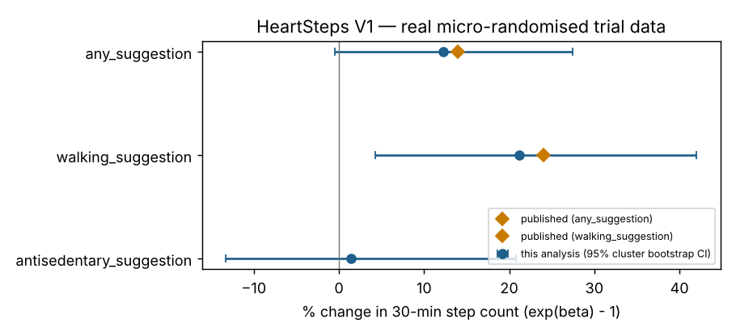
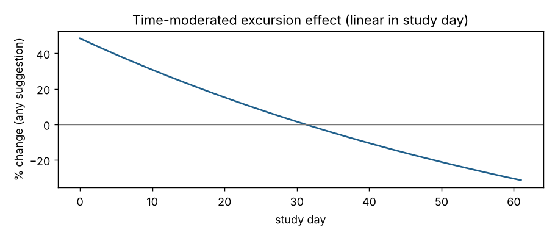

# exp07b_causal_grounding — Can our causal-estimation pipeline recover the published HeartSteps V1 suggestion effect?

> Real randomised-trial data (HeartSteps V1, CC-BY-4.0; Klasnja et al. 2019). Causal excursion effect of a mobile-health activity suggestion under the stated identification assumptions. Unrelated to, and not a validation of, any simulation result in this repository.

* Preregistration hash: `db680486f77f864f`
* **Status: PASSED** — any_suggestion: estimate +12.2% (95% cluster bootstrap CI [-0.5%, +27.4%]); published +14% (p = .06) lies inside the CI. Rule: consistent if log(1 + published_percent/100) lies inside our 95% cluster-bootstrap CI for the corresponding term; the primary comparison is any_suggestion.
* Data: Klasnja, P., Smith, S., Seewald, N. J., Lee, A., Hall, K., Luers, B., Hekler, E. B., & Murphy, S. A. (2019). Efficacy of Contextually Tailored Suggestions for Physical Activity: A Micro-randomized Optimization Trial of HeartSteps. Annals of Behavioral Medicine, 53(6), 573-582. doi:10.1093/abm/kay067; licence CC-BY-4.0 (LICENSE file in github.com/klasnja/HeartStepsV1 is 'Attribution 4.0 International'); sha256 `60ee7896183d7084a084f9a6e8ef2d0afea2e7fecdb41d6b15382ce1745c5ddb`
* Code version `0dc0d7b6aee0c9685dbad5da5687b3e0e16cf7b4`; LLM calls: 0

## Estimand and method

Marginal causal excursion effect (Boruvka et al. 2018) of A_t = suggestion delivered at an available decision point on Y_t = log(jbsteps30.zero + 0.5), averaged over study days and suggestion types; secondary: walking and anti-sedentary suggestions vs none; time-moderated effect (study day).

Outcome `log(jbsteps30.zero + 0.5)`; controls ['intercept', 'log(jbsteps30pre.zero + 0.5)', 'study_day']; centring: Treatment indicators centred at the empirical share of each treatment level among available decision points (constant over time), with p_tilde = p (unit weights). The design randomisation probabilities are not verified from the paper text in this session.

## Primary estimates

Analysis sample: 6590 available decision points from 37 participants; P(any)=0.594, P(walking)=0.332, P(anti-sedentary)=0.262; mean 30-min steps 213.7.

| term | beta (log) | % effect | 95% cluster bootstrap CI (%) | sandwich SE | p (t, df) |
|---|---|---|---|---|---|
| any_suggestion | +0.1154 | +12.2% | [-0.5, +27.4] | 0.0648 | 0.083 (36) |
| walking_suggestion | +0.1921 | +21.2% | [+4.2, +42.0] | 0.0812 | 0.024 (36) |
| antisedentary_suggestion | +0.0141 | +1.4% | [-13.3, +20.8] | 0.0852 | 0.869 (36) |

## Comparison with the published estimate (verified from the abstract, PMID 30192907)

* any_suggestion: published +14% (p = .06). Source text: "Averaging over study days and types of activity suggestions, delivering a suggestion versus no suggestion increased the 30-min step count by 14% (p = .06), 35 additional steps over the 253-step average."
* walking_suggestion: published +24% (p = .02). Source text: "Averaging over study days, delivering a walking suggestion versus no suggestion increased the average step count by 24% (59 steps; p = .02)."

| term | published (log) | inside our 95% CI | same sign |
|---|---|---|---|
| any_suggestion | +0.1310 | True | True |
| walking_suggestion | +0.2151 | True | True |

## Sensitivity analyses

| variant | term | % effect | 95% bootstrap CI (%) | p |
|---|---|---|---|---|
| complete_case | any_suggestion | +16.1% | [+2.0, +32.8] | 0.043 |
| complete_case | walking_suggestion | +22.4% | [+4.9, +43.8] | 0.019 |
| complete_case | antisedentary_suggestion | +8.0% | [-10.2, +31.1] | 0.430 |
| no_controls | any_suggestion | +10.3% | [-3.1, +25.9] | 0.164 |
| no_controls | walking_suggestion | +19.4% | [+0.7, +38.2] | 0.034 |
| no_controls | antisedentary_suggestion | -0.8% | [-18.3, +23.1] | 0.942 |
| nominal_centring | any_suggestion | +12.2% | [-0.4, +27.3] | 0.083 |
| nominal_centring | walking_suggestion | +21.2% | [+4.5, +42.0] | 0.024 |
| nominal_centring | antisedentary_suggestion | +1.4% | [-13.2, +20.2] | 0.869 |

## Time-moderated effect (exploratory secondary)

(A - p)(b0 + b1 (day - 22.0)): b0 = +0.1162, b1 = -0.01264 per study day (bootstrap CI [-0.02463, -0.00031]).





## Identification assumptions

* Treatment was randomised at each available decision point (micro-randomised trial design), so A_t is independent of potential outcomes given availability.
* Consistency and no interference between participants.
* Positivity: 0 < P(A_t = 1 | available) < 1.
* The estimand is a causal excursion effect conditional on availability, marginal over the realised treatment history; it is not a total effect of the HeartSteps programme.
* Zero-imputation of missing tracker minutes (jbsteps30.zero) follows the dataset's provided columns; complete-case is a sensitivity analysis.

## Validity notes

* The public dataset contains 37 participants; the paper reports a 6-week MRT with 44 adults. The analysed samples may differ.
* The paper's exact control covariates and outcome transform are not verified from its full text in this session (only the abstract was accessible).
* This is the only real causal estimate in the repository. It is not mixed with, and does not validate, any simulation result.

## Data checks

```json
{
 "analysis_sample": 6590,
 "analysis_users": 37,
 "available_decision_points": 6590,
 "complete_case_n": 5801,
 "max_study_day": 61,
 "mean_steps30_complete_case": 242.71108429581108,
 "mean_steps30_zero_imputed": 213.65204855842185,
 "p_sedentary_given_available": 0.2620637329286798,
 "p_send_given_available": 0.5940819423368741,
 "p_walking_given_available": 0.33186646433990896,
 "rows": 8274,
 "sent_with_unknown_or_inconsistent_type": 0,
 "users": 37
}
```
